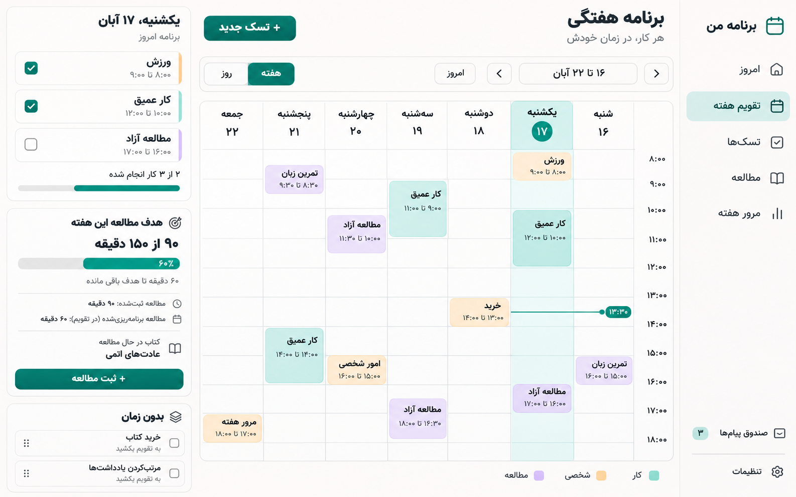
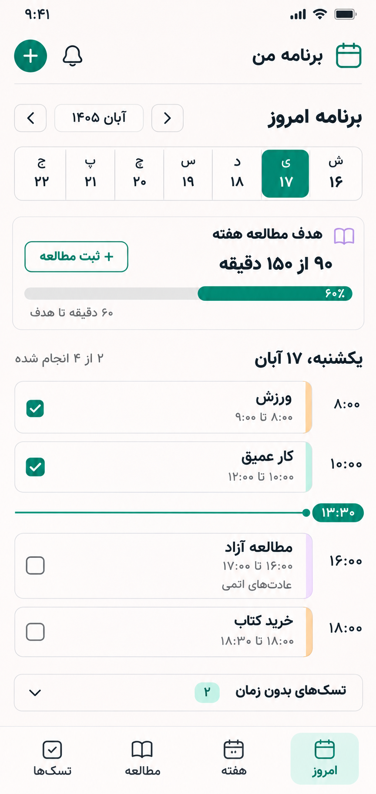
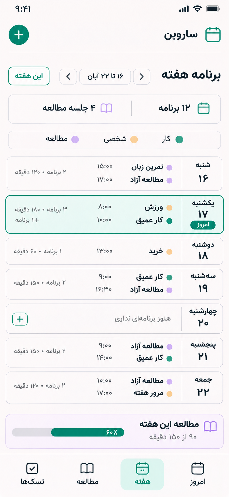

# Sarvin planner — Step-by-Step Implementation Plan

Document version: 1.0, complete English edition  
Prepared on: 2026-11-08  
Status: Features implemented; final browser acceptance and input-dependent setup/deployment remain open  
Audience: The implementation agent and project owner  
Product language: Persian, right-to-left  
Product type: A personal, single-user web application for mobile and desktop

> This file is both the product specification and the execution checklist. The user has reported that the initial setup is complete, but its source code was not available when this document was prepared. No feature or task is therefore marked Done in advance. Do not recreate the project; inspect the existing repository first.
>
> This is an English translation of the complete plan, not a change to the product language or scope. The application must remain Persian and RTL. The supplied reference screenshots intentionally show the Persian interface. English UI labels quoted in this document describe their meaning; implement their Persian equivalents.

## 1. Instructions for the Next Agent

1. Read this document, repository instructions, and the existing setup files.
2. Start with `STEP-00` and proceed in order, respecting dependencies. Execute tasks within each step from top to bottom.
3. Every task has a unique ID. Its initial state is `- [ ]`. Change it to `- [x]` only after actual implementation and verification against its completion criteria.
4. Partial work, visual-only implementations using mock data, unexecuted tests, and tasks awaiting input are not Done.
5. After completing each task, record its ID, changes, verification method, result, and commit if available in the Execution Log. Keep this file updated alongside the code.
6. At the end of each step, verify its exit criteria and then check its Gate task. A failed Gate prevents declaring dependent work complete.
7. If something already exists, verify it and record evidence. Rewriting it is not required to check the task.
8. Use this document's defaults for low-risk ambiguities. Do not invent real class times, a domain, server details, or passwords.
9. Record a localized blocker and continue independent work. Do not bypass dependencies or mark blocked tasks complete.
10. Record requirement changes in the Decision Log. Do not add optional features from the end of this document to the required scope without a user request.
11. Respect the existing setup, user changes, and package manager. Make major dependency upgrades only for a concrete need and document why.
12. Never put passwords, tokens, private connection details, or actual `.env` files in this document, Git, screenshots, or test output.

### Task Result Template

```text
Task: SP-xx-yy
Status: DONE | IN_PROGRESS | BLOCKED
Change: ...
Verification: The command or verification scenario and its actual result
Evidence: File path / test report / screenshot / commit
Blocker or next action: ...
```

Leave the checkbox unchecked for `IN_PROGRESS` and `BLOCKED`. If a completed task regresses, reopen its checkbox and dependent Gates, and record the reason.

## 2. Product Goal and Version-One Scope

The user must be able to capture tasks, assign time slots, view daily and weekly plans, mark tasks complete, and track actual non-academic reading against a weekly goal. Work hours and university classes are fixed commitments that must remain visible while planning.

### Confirmed Decisions

| Topic | Decision |
|---|---|
| Name | Sarvin planner; use the Persian spelling of Sarvin in the interface, as shown in the references |
| User | One owner account only; no public registration |
| Hosting | Public internet, on the user's own server; the domain will be provided later |
| Frontend | Next.js App Router, React, and TypeScript |
| UI | Tailwind CSS, shadcn/ui, RTL, and a Persian font |
| Frontend server state | TanStack Query |
| Backend | NestJS with a REST API; all business logic and database access belong in NestJS |
| Database | PostgreSQL with Prisma |
| Calendar | FullCalendar for the time grid, date-fns-jalali for Jalali dates, and an explicit timezone-handling layer |
| Infrastructure | pnpm workspaces, Docker Compose, and Caddy, adapted to the existing setup |
| Authentication | One pre-created account, server-side sessions, and a secure cookie |
| Time | Default timezone `Asia/Tehran`; weeks start on Saturday |
| Work schedule | Saturday, Sunday, Monday, Tuesday, and Wednesday, 08:00–13:00 every day |
| Days without work | No automatically generated work events on Thursday or Friday |
| University | Course names, weekdays, and start/end times will be supplied by the user; not yet provided |
| Logo | Calendar with a simple heart; use the version without a checkmark inside the heart |

### Implementation Defaults That May Be Changed with a Recorded Decision

- Display Persian dates and numerals and use a 24-hour clock. API contracts use Latin numerals and standardized time formats.
- Each weekly reading goal has one active unit: minutes, pages, or sessions. No actual target amount has been chosen; the user must set it.
- Ordinary tasks have low/normal/high priority and incomplete/completed status. Up to three tasks can be selected as a day's top priorities.
- Unscheduled tasks remain in the task inbox. Never silently move overdue tasks automatically.
- Estimated duration and actual reading duration are different. Checking a task does not create a reading session.
- Non-academic reading is independent of university classes. Attending a class does not increase the personal reading goal.
- Fixed commitments cannot normally be dragged or resized. Change them through their dedicated form or an exception for that occurrence.
- Show a visible scheduling-conflict warning. An intentional overlap can be saved after explicit user confirmation; do not automatically delete or move events.
- Version one is online. Clearly communicate disconnection. Offline writes and push notifications are not version-one commitments. PWA installation was subsequently authorized on 2026-11-09 and is tracked separately below.
- Refresh server data after mutations, tab focus, and reconnection. Version one does not require WebSockets.

## 3. Reference Images and Design Rules

Keep this file together with the `sarvin-planner-assets` folder. The images are design references; sample content, numbers, and possible image inaccuracies must not become real user data. The textual requirements take precedence, particularly the fixed work schedule added after the mockups were created.

### Desktop Weekly View



- Navigation sidebar on the right, weekly calendar in the center, selected-day details and reading progress on the left.
- Days run from Saturday on the right to Friday on the left. Place the time gutter on the right side of the grid.
- The top toolbar contains the title, selected week, previous/next week, return to today, and add-task controls.
- Clearly distinguish the selected day, today, current time, and completion state.
- The left panel contains the day's plan, top priorities, reading progress, and unscheduled tasks.
- The updated work requirement occupies 08:00–13:00 from Saturday through Wednesday. Do not seed conflicting sample tasks directly from the image.

### Mobile Today View



- Compact header with brand/logo and add action, followed by a compact seven-day selector.
- Reading-goal card, day heading and completion status, vertical day timeline, and event cards.
- Fixed events have a lock icon/label; ordinary tasks have a completion control.
- Fixed bottom navigation: Today, Week, Reading, Tasks. Scrolling content must not disappear behind it.

### Mobile Week Tab



- An agenda with seven day cards, Saturday through Friday; not a shrunken seven-column desktop grid.
- Each card shows the weekday/date, schedule summary, times, activity count, and total occupied duration without double-counting overlaps.
- Highlight today. Empty days have a message and quick-add action. Tapping a day opens that day's details.
- For busy days, show two or three items and a “+N more events” indicator. All items remain accessible in day details.
- Include fixed work in the summary while retaining useful space for other activities.
- Allow vertical scrolling when needed. Do not shrink text or controls just to force all seven days into one viewport.

### Approved Logo


- Use the no-checkmark version. Do not reintroduce the checkmark.
- The original asset is PNG. An SVG requires actual, controlled vector recreation or tracing, not a renamed extension.
- Keep icons, favicon, and page title consistent with the Sarvin planner identity.

### Proposed Visual System

| Token/component | Target value or behavior |
|---|---|
| Primary color | Teal near `#008D80`; adjust text/button shades for sufficient contrast |
| Background | Warm white near `#FAF9F7` |
| Card surface | White, a light border, and a very subtle shadow |
| Text | Charcoal; legible secondary text |
| Reading | Light lavender with dark text |
| Personal | Light amber with dark text |
| Fixed work | Pale teal, a “Fixed” label, and a lock icon |
| University | Soft blue, a “Class” label, and an appropriate icon |
| Font | Vazirmatn or an existing properly licensed Persian font, preferably hosted locally |
| Radius | Approximately 12–16px, consistent across components |
| Touch targets | Generally at least 44×44px |
| Density | Readable with sufficient spacing and little decorative whitespace |
| Direction | `lang="fa"`, `dir="rtl"`, and CSS logical properties |
| Breakpoints | Mobile below 768px, tablet 768–1199px, desktop from 1200px; adjust to actual content needs |

Some reference images contain a notification bell or illustrative counters. Do not build nonfunctional controls, fabricated counts, or dead links. Omit the bell from the main release until notifications are implemented.

## 4. Domain Contracts to Finalize Before Building the UI

### 4.1 Time and Recurrence

- Use half-open intervals: `[start, end)`. An event ending at 13:00 does not conflict with another starting at 13:00.
- Store timed events as UTC instants. Input and display use `Asia/Tehran`.
- Define recurrence using weekday, local wall-clock time, timezone, and effective start/end dates, not by repeatedly adding a fixed 24 hours in UTC.
- A date without a time, such as a due date or week-start identifier, is a Local Date. Do not accidentally convert it to midnight UTC.
- A week runs from Saturday 00:00 Tehran time to the following Saturday 00:00 Tehran time. Derive UTC boundaries through timezone conversion.
- Document weekday numbering in the database/API, such as ISO Monday=1 through Sunday=7, with Saturday=6. RTL ordering does not change weekday numbering.
- University odd/even weeks require a reference Saturday and the user's explicit definition. Do not infer them from Gregorian week numbers.
- Expand recurring occurrences only for the requested range. Do not generate infinite occurrences or seed thousands of years.
- Give each occurrence a stable identity derived from its series and original date/time. Rescheduling must not destroy its original identity.
- Support “this occurrence only” and “this and future occurrences” edits. Never silently rewrite past history.
- Public holidays are not handled automatically. A day off or canceled class is an occurrence exception.
- The day view must cover all 24 hours. Initially scrolling to a useful time is allowed; hiding events outside 08:00–18:00 is not.
- An event spanning midnight remains one logical record but appears in both days with a continuation indicator.

### 4.2 Tasks, Fixed Commitments, and Reading

- A task has a title, optional description, category, priority, optional estimated duration, optional due date, status, and completion timestamp.
- Scheduling associates a task with a time interval. In version one, each task occurrence has at most one active time block. Automatically splitting one task into multiple blocks is out of scope.
- Each recurring task occurrence has its own status. Completing one does not complete the entire series.
- Work and classes are fixed commitments. Exclude them from the denominator of task-completion statistics; they do not inherently need checkboxes.
- Calculate a day's occupied duration from the union of intervals to avoid double-counting overlaps. Include work and classes when calculating the day's load.
- A reading session records when it occurred, a positive actual duration, an optional book/topic, and a note. Pages, if supplied, must be positive. Unplanned reading can be logged with its actual time.
- A calendar reading block is only a plan. Logging an actual reading session is a separate action, even when initiated from that card.
- If a reading session is linked to a task, completing the task is an explicit choice. Editing or deleting reading must not silently change task status.
- Minute goals use actual minutes; page goals use actual pages; session goals count valid sessions in the relevant week.
- For a session crossing a week boundary, allocate minutes according to overlap with each week. Allocate session count and pages to the week in which the session started. Briefly explain this behavior in the UI.
- The text percentage may exceed 100%; the progress bar width is capped at 100%. Zero or negative targets are invalid. “No goal set” is a separate state.
- Reread pages may count toward a reading goal. Do not infer book-completion progress solely from total logged pages.

### 4.3 Conflicts and Synchronization

- Before saving or editing a schedule, check server-side for conflicts with other tasks, work, and classes.
- Warnings include the titles, intervals, and types of conflicting events. Offer edit, cancel, or save with explicit confirmation.
- Tie confirmation to the version or snapshot the user reviewed. If a new conflict appears between checking and saving, show the warning again.
- Moves may update the UI optimistically. Roll back on a server error and clearly explain the failure.
- Use `version` or `updatedAt` to handle concurrent edits from two devices. A stale write must not silently overwrite a newer change.
- Prevent duplicate tasks/reading sessions caused by double-taps or retries using idempotency or an equivalent mechanism.

## 5. Implementation Roadmap

| Step | Deliverable | Dependencies |
|---|---|---|
| 00 | Understand and verify the existing setup | None |
| 01 | Domain decisions and API contracts | 00 |
| 02 | Design foundations and Jalali calendar feasibility | 01 |
| 03 | Database and migrations | 01 |
| 04 | Authentication and access control | 03 |
| 05 | Time and recurrence engine | 01, 03 |
| 06 | Task and fixed-schedule APIs | 04, 05 |
| 07 | Reading and reporting APIs | 04, 05, 06 |
| 08 | Secure frontend/API integration | 02, 04, 06, 07 |
| 09 | App shell and login UI | 08 |
| 10 | Today page | 09 |
| 11 | Desktop weekly calendar | 10 |
| 12 | Mobile Week tab | 11 |
| 13 | Task inbox and shared forms | 10, 11, 12 |
| 14 | Work and university schedule management | 06, 13 |
| 15 | Reading page | 07, 13 |
| 16 | Weekly review and settings | 14, 15; actual class entry may remain pending |
| 17 | Experience quality and accessibility | 09 through 16 |
| 18 | Integrated acceptance testing | 17 |
| 19 | Server deployment | 18 and actual server/domain details |
| 20 | Handoff and outstanding-item tracking | 19; keep class-data status explicit |

Execute steps in numerical order. Dependencies identify independent work when a blocker occurs; they do not authorize marking an incomplete step Done. Test each capability during implementation. STEP-18 is not the first time errors should be discovered.

---

## STEP-00 — Inspect the Existing Setup

Goal: Continue safely from the existing project with an accurate understanding of its state.

- [x] **SP-00-01** — **Done** — Inspect the correct repository, `AGENTS.md` instructions, branch, Git status, and user changes. Record paths and baseline state.
- [x] **SP-00-02** — **Done** — Identify the workspace structure, `apps/web`, `apps/api`, package manager, lockfile, Node version, and installed versions. Do not scaffold the project again.
- [x] **SP-00-03** — **Done** — Verify local startup of web, API, and PostgreSQL using existing commands. Fix baseline issues and document working commands.
- [x] **SP-00-04** — **Done** — Check the Prisma connection, existing migrations, and health endpoint. Do not recreate working components.
- [x] **SP-00-05** — **Done** — Separate environment configuration correctly: placeholders only in `.env.example`, no secrets in browser variables, and a correct `.gitignore`.
- [x] **SP-00-06** — **Done** — Run baseline build, typecheck, and lint, plus existing tests if present. Identify pre-existing failures.
- [x] **SP-00-07** — **Done** — Put this document and reference images in the repository's documentation directory. Preserve relative image paths and record the canonical checklist location.
- [x] **SP-00-GATE** — **Done** — Exit criteria: The setup runs, its actual state is recorded, and the continuation plan fits the existing structure.

## STEP-01 — Finalize the Domain and Contracts

- [x] **SP-01-01** — **Done** — Turn confirmed decisions and defaults into implementation contracts. Record differences between the setup and this document in the Decision Log.
- [x] **SP-01-02** — **Done** — Define Task, ScheduledTaskOccurrence, FixedSeries, OccurrenceException, Book, ReadingSession, WeeklyGoal, and Session types.
- [x] **SP-01-03** — **Done** — Document time rules, half-open intervals, week boundaries, weekday numbering, Jalali dates, recurrence occurrences, and exceptions.
- [x] **SP-01-04** — **Done** — Finalize KPI definitions: completed tasks, event count, occupied time, actual reading, and goals. Exclude fixed commitments from task-completion statistics.
- [x] **SP-01-05** — **Done** — Define conflicts, series edits, deletion, returning tasks to the inbox, and rescheduling unfinished tasks. Never implicitly rewrite the past.
- [x] **SP-01-06** — **Done** — Prepare REST contracts with input/output DTOs, errors, pagination, range filters, versioning, and idempotency. Maintain them in Swagger/OpenAPI or the existing tool.
- [x] **SP-01-07** — **Done** — Record missing inputs in the Pending Inputs table: classes, fixed-schedule start date, actual reading target, server, and domain.
- [x] **SP-01-GATE** — **Done** — Exit criteria: Contracts are sufficient for implementation without inventing personal information.

## STEP-02 — Design System and Calendar Feasibility

- [x] **SP-02-01** — **Done** — Inspect the reference images and identify shared components: AppShell, Sidebar, BottomNav, WeekPicker, DayCard, EventCard, GoalCard, TaskForm, and ConfirmDialog.
- [x] **SP-02-02** — **Done** — Centralize color, spacing, radius, font, focus, error, disabled, and loading tokens.
- [x] **SP-02-03** — **Done** — Enable RTL at the root and in portals, dialogs, dropdowns, tooltips, and forms. Give time/code/email inputs an independent LTR direction where appropriate.
- [x] **SP-02-04** — **Done** — Add the approved heart logo without a checkmark. Prepare readable header sizing, favicon, and metadata.
- [x] **SP-02-05** — **Done** — Build a limited FullCalendar prototype and check React/Next compatibility, plugin licenses, RTL, Saturday week start, drag/resize, and fixed events. Do not add paid plugins without a need.
- [x] **SP-02-06** — **Done** — Prove actual Jalali dates in headings, columns, and the date picker. `locale=fa` alone does not satisfy acceptance. Check Nowruz, month ends, and week navigation.
- [x] **SP-02-07** — **Done** — Test Tehran time conversion with the browser in another timezone. If necessary, select and document a compatible IANA-timezone utility.
- [x] **SP-02-08** — **Done** — If the calendar tooling cannot satisfy requirements, document an alternative renderer or date-picker approach and resolve it before building the full page.
- [x] **SP-02-GATE** — **Done** — Exit criteria: Base components and the calendar prototype are interactive, Persian, and Jalali-aware, rather than static images.

## STEP-03 — Data Model and Migrations

Minimum proposed model: names may follow the existing structure, but preserve the semantics.

| Model | Core data |
|---|---|
| Owner/User | Owner ID, login email, password hash, timestamps |
| AuthSession | Identifier/token hash, owner, expiration, revocation, last use |
| UserSettings | Timezone, week start, display settings, default goal |
| Task | Title, description, category, priority, estimate, dueDate, status for a one-off task |
| TaskSeries | Optional task recurrence rule and effective dates |
| TaskOccurrence | Occurrence ID, optional time, independent status, completedAt, version |
| FixedSeries | work/class type, title, weekdays, local time, timezone, effective dates, optional parity |
| OccurrenceException | Original occurrence key, cancel/override action, replacement data |
| Book/Topic | Title, optional author, optional totalPages, status, optional current page |
| ReadingSession | Actual start/end, duration, optional pages, book/topic, note, optional occurrence link |
| WeeklyGoal | Owner, local weekStart, unit, target |
| DailyPriority | localDate, occurrence/task reference, order 1 through 3 |

- [x] **SP-03-01** — **Done** — Create or extend the Prisma schema, separating tasks from scheduling, fixed commitments, and actual reading.
- [x] **SP-03-02** — **Done** — Define ownership, relationships, foreign keys, and deletion behavior. Deleting a book or task must not inadvertently delete historical reading.
- [x] **SP-03-03** — **Done** — Use appropriate PostgreSQL datetime types such as `timestamptz` and a date-only contract for localDate. Document precision and conversions.
- [x] **SP-03-04** — **Done** — Enforce positive goals/durations/pages, end-after-start, and one-goal-per-week uniqueness at the appropriate layers.
- [x] **SP-03-05** — **Done** — Design uniqueness for series occurrences, occurrence exceptions, DailyPriority, and idempotent operations. Running seeds again must not create duplicates.
- [x] **SP-03-06** — **Done** — Add indexes for owner plus time, task status, reading sessions, and session expiration as needed.
- [x] **SP-03-07** — **Done** — Prepare reproducible migrations for a fresh database and an upgrade path for an existing database. Do not run destructive commands on real data.
- [x] **SP-03-08** — **Done** — Separate development seeds from real bootstrap operations. Sample data belongs only in development/test, with no public default password.
- [x] **SP-03-09** — **Done** — Make bootstrapping the Saturday–Wednesday, 08:00–13:00 work schedule idempotent. Obtain its effective start date through initial user setup.
- [x] **SP-03-10** — **Done** — Do not seed fabricated titles or numbers as real books, classes, or goals. Provide empty states.
- [x] **SP-03-GATE** — **Done** — Exit criteria: Migrations succeed on a clean database, relationships are valid, and the model supports history and recurrence.

## STEP-04 — Single-User Authentication and Access Control

- [x] **SP-04-01** — **Done** — Set up Auth using a maintained mechanism compatible with the installed Nest version. Do not invent cryptography or a custom token generator.
- [x] **SP-04-02** — **Done** — Build a secure owner creation/recovery command. Permit one owner only, expose no public signup endpoint, and never print passwords to logs.
- [x] **SP-04-03** — **Done** — Store passwords with an appropriate password-hashing algorithm such as Argon2id. Use a reputable library and document its parameters.
- [x] **SP-04-04** — **Done** — Implement login, logout, me, and revoke-all-sessions. Store sessions with finite expiry in PostgreSQL and issue a fresh session at login.
- [x] **SP-04-05** — **Done** — Configure session cookies with HttpOnly, Secure on HTTPS, and an appropriate SameSite policy. Handle local development and trust proxy behind Caddy correctly. Do not store tokens in localStorage.
- [x] **SP-04-06** — **Done** — Protect state-changing operations from CSRF using standard tooling and appropriate Origin checks. Do not rely solely on SameSite.
- [x] **SP-04-07** — **Done** — Add login rate limits, generic failure messages, input limits, and expired-session cleanup. Errors must not reveal whether an account exists.
- [x] **SP-04-08** — **Done** — Apply a global Guard to private APIs and ownership checks in every relevant service. Hiding a Next.js page is not authorization.
- [x] **SP-04-09** — **Done** — Explicitly identify the small public route set, such as login and health. Public health responses must not expose database/configuration details.
- [x] **SP-04-10** — **Done** — Run real tests for successful/failed login, anonymous requests, expired cookies, logout, CSRF, and unauthorized identifier access.
- [x] **SP-04-GATE** — **Done** — Exit criteria: Only the owner can access data, sessions remain valid as intended, and logout/expiry actually revoke access.

## STEP-05 — Time, Recurrence, and Fixed-Schedule Engine

- [x] **SP-05-01** — **Done** — Build shared date/time utilities for today in the user's timezone, week boundaries, UTC/Tehran conversion, and Jalali display.
- [x] **SP-05-02** — **Done** — Standardize date inputs/outputs in the API. Normalize Persian numeral input in the UI and reject invalid dates.
- [x] **SP-05-03** — **Done** — Implement weekly occurrence expansion using weekdays, local time, effectiveFrom/effectiveUntil, and a bounded requested range.
- [x] **SP-05-04** — **Done** — Support daily/selected-weekday recurrence for ordinary tasks and weekly recurrence for work/classes, with optional recurrence end dates.
- [x] **SP-05-05** — **Done** — Implement stable occurrence identity, independent status, and bounded on-demand materialization. Refreshing must not create duplicates.
- [x] **SP-05-06** — **Done** — Implement cancel/override for one occurrence only, leaving the original series unchanged.
- [x] **SP-05-07** — **Done** — Implement “this and future occurrences” edits by splitting or versioning the series. Preserve history and exceptions without unintended deletion.
- [x] **SP-05-08** — **Done** — Implement alternating-week classes using a reference Saturday and explicit parity. Do not save without a valid anchor.
- [x] **SP-05-09** — **Done** — Implement overlap detection, cross-midnight intervals, and the union of occupied intervals.
- [x] **SP-05-10** — **Done** — Generate work events exactly Saturday through Wednesday, 08:00–13:00. Generate none on Thursday/Friday or before effectiveFrom.
- [x] **SP-05-11** — **Done** — Run independent tests for Saturday/Friday boundaries, Jalali month/year changes, leap dates, non-Tehran browser timezones, the 13:00 boundary, and exceptions.
- [x] **SP-05-GATE** — **Done** — Exit criteria: The API and UI use identical time semantics, and boundary dates work without shifting to another day.

## STEP-06 — Tasks, Scheduling, and Conflict APIs

- [x] **SP-06-01** — **Done** — Create Tasks, Schedule, FixedSchedules, and Settings modules with services independent of the UI.
- [x] **SP-06-02** — **Done** — Build task CRUD with required title and optional description, category, priority, estimate, and dueDate. Add status/category filters and search.
- [x] **SP-06-03** — **Done** — Implement scheduling, moving, resizing, and unscheduling. Removing the schedule must not delete the task.
- [x] **SP-06-04** — **Done** — Make occurrence completion/reopening idempotent, correctly updating completedAt and version.
- [x] **SP-06-05** — **Done** — Build a bounded day/week schedule endpoint. Return task/work/class events in a shared display structure with explicit type and editing capabilities.
- [x] **SP-06-06** — **Done** — Save schedules with conflict checks, structured conflict responses, and an informed-confirmation path. Revalidate at commit time.
- [x] **SP-06-07** — **Done** — Apply version and write-race checks to move/update/delete. Return a conflict and fresh data for stale changes.
- [x] **SP-06-08** — **Done** — Enforce fixed-event drag/resize restrictions in the API too. The ordinary task-move endpoint must not modify work/classes.
- [x] **SP-06-09** — **Done** — Implement fixed-series CRUD, exceptions, and series termination for work/class types. Check series conflicts using weekday, time, effective range, and parity.
- [x] **SP-06-10** — **Done** — Add three daily priorities and unfinished-task handling: new time, return to inbox, or confirmed deletion.
- [x] **SP-06-11** — **Done** — Implement task/series deletion with explicit scope and a history/reading-retention policy. Roll back partial failures within transactions.
- [x] **SP-06-12** — **Done** — Run API tests for CRUD, recurring occurrences, work conflicts, confirmed overlaps, version control, and denial of anonymous access.
- [x] **SP-06-GATE** — **Done** — Exit criteria: The entire create, schedule, complete, move, and delete lifecycle is demonstrable without the UI.

## STEP-07 — Reading, Goals, and Reporting APIs

- [x] **SP-07-01** — **Done** — Build book/topic CRUD, reading/finished/archived status, and optional author/page fields.
- [x] **SP-07-02** — **Done** — Implement create/edit/delete for actual reading sessions with date, time, duration, optional pages, and a note. Future actual reading is invalid.
- [x] **SP-07-03** — **Done** — Convert quick-entry “date + start time + duration” into one actual interval. Reject inconsistent duration and end-time values.
- [x] **SP-07-04** — **Done** — Support optional task links and unplanned reading. Prevent retry-induced duplicates.
- [x] **SP-07-05** — **Done** — Implement weekly-goal CRUD for minutes/pages/sessions, positive targets, and week uniqueness. Changing one week must not change earlier weeks' goals.
- [x] **SP-07-06** — **Done** — Support a default for future weeks and a “No goal set yet” state. Do not record a fabricated number as the user's choice.
- [x] **SP-07-07** — **Done** — Aggregate actual progress, remaining amount, and goal overachievement. Return planned reading separately from logged reading.
- [x] **SP-07-08** — **Done** — Build weekly reporting for completed/remaining tasks, scheduled duration, actual reading, and goal comparison. Do not confuse fixed commitments with tasks.
- [x] **SP-07-09** — **Done** — Recompute all relevant statistics correctly after session edits/deletions. Avoid stale summaries and double-counting.
- [x] **SP-07-10** — **Done** — Test different goal units, a week without a goal, cross-week sessions, book deletion with history retention, and task completion without reading progress.
- [x] **SP-07-GATE** — **Done** — Exit criteria: Statistics match independently calculable examples, and planned activity is kept separate from actual activity.

## STEP-08 — Typed Contracts and Frontend Integration

- [x] **SP-08-01** — **Done** — Build a typed API client from OpenAPI or shared contracts. Do not include Prisma models or secrets in the browser bundle.
- [x] **SP-08-02** — **Done** — Define consistent query keys for days, weeks, tasks, fixed commitments, reading, goals, and settings.
- [x] **SP-08-03** — **Done** — Centralize credentialed requests, CSRF handling, 401/403/409 responses, and Persian error messages.
- [x] **SP-08-04** — **Done** — Define post-mutation invalidation. For example, logging reading must refresh the Today card, Week view, Reading page, and weekly review.
- [x] **SP-08-05** — **Done** — Implement optimistic move/complete operations with rollback. Control duplicate creation and repeated submission.
- [x] **SP-08-06** — **Done** — Clear private-data caches on login/logout. Private data must not be shared through public Next.js/CDN caching.
- [x] **SP-08-07** — **Done** — Cover loading, empty, error, retry, and session-expired states in hooks/components. Avoid indefinite spinners.
- [x] **SP-08-GATE** — **Done** — Exit criteria: A prototype interface uses the real API, with defined behavior for network failures, conflicts, and logout.

## STEP-09 — App Shell and Login

- [x] **SP-09-01** — **Done** — Create `/login`, `/today`, `/week`, `/tasks`, `/reading`, `/review`, and `/settings`, or consistent equivalents. Redirect the root to the appropriate destination.
- [x] **SP-09-02** — **Done** — Build a compact Persian login page with labels, show/hide password, errors, and a pending state. Do not expose public registration.
- [x] **SP-09-03** — **Done** — Build the desktop sidebar with Today, Week, Tasks, Reading, Weekly Review, and Settings. Clearly indicate the active route.
- [x] **SP-09-04** — **Done** — Build mobile bottom navigation with Today, Week, Reading, and Tasks. Make Settings and Weekly Review accessible through the header menu.
- [x] **SP-09-05** — **Done** — Implement the header, logo, quick-add action, bottom safe-area padding, and tablet behavior. Do not display a dummy or nonfunctional notification bell.
- [x] **SP-09-06** — **Done** — Build brief onboarding to confirm timezone, work-schedule start date, and an optional reading goal. Missing class information must not block entry to the app.
- [x] **SP-09-07** — **Done** — Implement UI guards, preserve the intended destination after login, and support day/week deep links. Keep the URL date through refresh and back/forward navigation.
- [x] **SP-09-GATE** — **Done** — Exit criteria: The owner can sign in, navigate all sections, and sign out. Controls remain accessible on mobile.

## STEP-10 — Today Page and Day Details

- [x] **SP-10-01** — **Done** — Build a seven-day selector with Jalali dates, selected-day state, and a today indicator. Week changes and return-to-today must work correctly.
- [x] **SP-10-02** — **Done** — Build the day timeline from real API data containing work, classes, and tasks. Include access to events outside work hours and across midnight.
- [x] **SP-10-03** — **Done** — Build task cards with time, title, category, priority, and complete/reopen actions. Fixed-event cards show a label and details without a misleading checkbox.
- [x] **SP-10-04** — **Done** — Show the current-time line only for today, using Tehran time. Hide it on past/future days and update it as time passes.
- [x] **SP-10-05** — **Done** — Build the reading-goal card with actual amount, target, remaining amount, and a log action. Cover no goal, goal reached, and overachievement states.
- [x] **SP-10-06** — **Done** — Build three daily priorities and an accurate completed-task counter. Exclude work/classes from the denominator.
- [x] **SP-10-07** — **Done** — Build the unscheduled section and access to overdue tasks, with actions to move to another date, return to inbox, or delete.
- [x] **SP-10-08** — **Done** — Connect adding on the selected day, opening details, editing, deleting, and logging reading from a reading event to shared forms.
- [x] **SP-10-09** — **Done** — Check an empty day, busy day, long titles, overlaps, and disconnection. Do not truncate text without a way to read it in full.
- [x] **SP-10-GATE** — **Done** — Exit criteria: The daily workflow works with real data, from adding tasks to completion and reading logs.

## STEP-11 — Desktop Weekly View

- [x] **SP-11-01** — **Done** — Build the reference three-part layout with appropriate minimum widths: sidebar on the right, grid in the center, day panel on the left.
- [x] **SP-11-02** — **Done** — Implement seven columns from Saturday to Friday, Jalali headings, Tehran time, time scrolling, and previous/next week navigation.
- [x] **SP-11-03** — **Done** — Display fixed Saturday–Wednesday work from 08:00–13:00, classes, and tasks using distinguishable colors and labels.
- [x] **SP-11-04** — **Done** — Clicking a day/event updates the day panel. Selecting an empty interval opens the task form with that interval prefilled.
- [ ] **SP-11-05** — Connect ordinary-task drag/resize with documented time snapping, feedback, overlap confirmation, and rollback. Fixed commitments cannot be dragged.
- [ ] **SP-11-06** — Implement moving an unscheduled task into the grid and an equivalent form-based path. Provide a keyboard-accessible alternative.
- [ ] **SP-11-07** — Render concurrent events, long titles, short events, and midnight-spanning events legibly. Fixed events must not prevent selecting overlapping events.
- [x] **SP-11-08** — **Done** — Include the selected day, priorities, reading statistics, and inbox in the left panel. Changing the day must actually change the panel data.
- [x] **SP-11-09** — **Done** — Capture real screenshots at widths of 1280 and 1440 and compare hierarchy, RTL, and usability with the reference.
- [ ] **SP-11-GATE** — Exit criteria: Weekly planning works through drag interactions and forms, and data survives refresh.

## STEP-12 — Mobile Week Tab

- [x] **SP-12-01** — **Done** — Build the separate seven-day agenda layout shown in the reference, using the same API data as desktop.
- [x] **SP-12-02** — **Done** — Implement the week heading, arrows, “This week” action, event count, and planned-reading count. Derive counts from real data.
- [x] **SP-12-03** — **Done** — Each day card shows its name/date, event summary, occupied duration, additional-item count, and today indicator.
- [x] **SP-12-04** — **Done** — Cover empty days, days containing only fixed work, busy days, and conflicting events. Identify fixed events with a lock.
- [ ] **SP-12-05** — Tapping a card opens that day's details. Back navigation returns to the same week and a reasonable scroll position.
- [x] **SP-12-06** — **Done** — Adding from an empty day/card opens a form prefilled with that date. Editing time must not depend on dragging.
- [x] **SP-12-07** — **Done** — Show reading progress for the selected week and highlight the Week tab. Do not mix a past week's schedule with the current week's statistics.
- [x] **SP-12-08** — **Done** — Check widths of 360, 390, and 430, plus landscape. No text/buttons may hide behind bottom navigation, and no unintended horizontal scrolling should occur.
- [ ] **SP-12-GATE** — Exit criteria: Browsing all seven days, opening a day, and adding plans work comfortably by touch.

## STEP-13 — Task Inbox and Shared Forms

- [x] **SP-13-01** — **Done** — Build the Tasks page with unscheduled, scheduled, overdue, and completed tabs/filters. Add search and category/priority filters.
- [x] **SP-13-02** — **Done** — Build a shared create/edit form for title, description, category, priority, duration, due date, and optional scheduling. Quick add requires only a title.
- [x] **SP-13-03** — **Done** — Build recurrence controls for selected weekdays, start/end dates, and a preview of upcoming occurrences. Use the same authoritative backend logic for the preview.
- [ ] **SP-13-04** — Use an appropriate desktop dialog and mobile sheet/page. Keep the submit action reachable when the mobile keyboard is open.
- [x] **SP-13-05** — **Done** — Implement Persian field errors, pending states, duplicate-submit prevention, and a warning when leaving a dirty form.
- [x] **SP-13-06** — **Done** — Make detailed conflict warnings, editing, and confirmed saves consistent across entry points. Dragging and forms must not behave differently.
- [x] **SP-13-07** — **Done** — Require explicit scope for editing/deleting recurring occurrences. An ordinary occurrence action must not modify the whole series.
- [x] **SP-13-08** — **Done** — Connect complete/reopen, return to inbox, change day, and three daily priorities to the API. Refresh all affected views.
- [ ] **SP-13-09** — Verify the unscheduled task → calendar → conflict → new time → complete → reopen scenario on mobile and desktop.
- [ ] **SP-13-GATE** — Exit criteria: All main create/edit paths are functional, and every action has a persistent result.

## STEP-14 — Fixed Work and University Classes

- [x] **SP-14-01** — **Done** — Build an accessible “Fixed schedules” section within Settings or a dedicated route. Separate work and university groups.
- [x] **SP-14-02** — **Done** — Show work on Saturday through Wednesday, 08:00–13:00. Preserve the exact default and permit changes only through an explicit form.
- [x] **SP-14-03** — **Done** — Build the class form with course name, weekday(s), start/end time, term start/end dates, optional location, and weekly/alternating-week recurrence.
- [x] **SP-14-04** — **Done** — Require an odd/even reference and occurrence preview for alternating-week classes. An “even week” label without a calendar definition is insufficient.
- [x] **SP-14-05** — **Done** — Implement canceling a work occurrence, taking a day off, canceling one class, or changing one occurrence's time through exceptions. Leave the rest of the series unchanged.
- [x] **SP-14-06** — **Done** — Implement changes effective from a chosen date and term-end behavior. Preserve previous weeks' history.
- [x] **SP-14-07** — **Done** — Show class conflicts with work/other classes, including titles and times. Offer an informed decision instead of automatic resolution.
- [x] **SP-14-08** — **Done** — Show an empty state when actual class data is absent. Keep its pending-input record open and keep sample class data out of production.
- [ ] **SP-14-GATE** — Exit criteria: Fixed-schedule management is verified with test fixtures, and the actual work schedule is correct. This Gate does not depend on receiving real classes.
- [x] **SP-14-INPUT** — **Done** — Entered the three user-supplied weekly music commitments through the authenticated API. Verified weekdays, Tehran times, fixed-event restrictions and recurrence from the confirmed 2026-11-09 start with no end date; no conflicts returned. See 2026-11-09 execution log and QA evidence.

## STEP-15 — Reading Page

- [x] **SP-15-01** — **Done** — Build the Reading page with week selection, a goal card, session logging, the current book/topic, and history.
- [x] **SP-15-02** — **Done** — Implement setting/editing goals in minutes/pages/sessions, explaining that changes affect the selected week. Provide a clear action when no goal exists.
- [x] **SP-15-03** — **Done** — Build quick reading entry with date, time, duration, optional pages, book, and note. Default to now but allow changes.
- [x] **SP-15-04** — **Done** — Support unplanned reading and logging from a calendar card. Actual duration need not equal the reserved duration.
- [x] **SP-15-05** — **Done** — Label actual and planned reading separately. Completing a task must not advance actual reading progress.
- [x] **SP-15-06** — **Done** — Build add/edit/archive operations for books or topics and book-status controls. Archiving must preserve history.
- [x] **SP-15-07** — **Done** — Build session history with week/book filters, editing, and confirmed deletion. Make the “What did I learn?” note accessible.
- [x] **SP-15-08** — **Done** — Show the remaining amount, goal reached/overachieved states, and no-reading state. Use correct labels for different goal units.
- [x] **SP-15-09** — **Done** — A “Plan the next session” action opens the reading-task form. It must not automatically log actual reading.
- [x] **SP-15-GATE** — **Done** — Exit criteria: A goal can be set, actual sessions can be created/edited/deleted, and all related statistics update accurately.

## STEP-16 — Weekly Review and Settings

- [x] **SP-16-01** — **Done** — Build a review page with week selection, completed/remaining tasks, actual reading, goal, and scheduled duration. Label the current week as in progress.
- [x] **SP-16-02** — **Done** — Provide a simple daily-reading chart or an equivalent text summary using real data. Axes and units must be legible and Persian.
- [x] **SP-16-03** — **Done** — Build an unfinished-task list with reschedule, return-to-inbox, and delete actions. Check conflicts when moving items to the next week.
- [x] **SP-16-04** — **Done** — Clearly display timezone and week start in Settings. Saturday may remain fixed in version one. A timezone change must not silently reinterpret recurring schedules.
- [x] **SP-16-05** — **Done** — Add default-goal settings for future weeks and access to fixed schedules. Preserve earlier weeks' goals.
- [x] **SP-16-06** — **Done** — Complete and document logout, revoke-all-sessions, and a secure password-change/recovery path.
- [x] **SP-16-07** — **Done** — Provide a versioned personal-data JSON export containing tasks, schedules, exceptions, reading, goals, and settings. Exclude sessions and password hashes.
- [x] **SP-16-08** — **Done** — Complete save/error feedback and short help links. Do not leave unimplemented or placeholder sections in navigation.
- [ ] **SP-16-GATE** — Exit criteria: The user can review a week, manage unfinished work, and export personal data.

## STEP-17 — Experience Quality, Synchronization, and Accessibility

- [x] **SP-17-01** — **Done** — Review empty/loading/error/retry states for every page and form. Messages must be Persian, specific, and actionable.
- [ ] **SP-17-02** — Test disconnection during saves/moves. Do not show false success or lose previous data.
- [ ] **SP-17-03** — Refresh data on focus and reconnect. Handle conflicts between tabs/devices with feedback and an option to load the fresh version.
- [ ] **SP-17-04** — Check keyboard navigation, focus rings, focus traps, Escape behavior, focus restoration, and control labels.
- [x] **SP-17-05** — **Done** — Do not communicate event meaning through color alone. Provide text/icons, readable contrast, and screen-reader announcements for outcomes/errors.
- [x] **SP-17-06** — **Done** — Check Persian and mixed-language text, long titles, numerals, units, email, and time in RTL. Do not reverse digits or the order of time ranges.
- [ ] **SP-17-07** — Check safe areas, the mobile keyboard, sheet scrolling, bottom navigation, landscape, and zoom at target viewport sizes.
- [x] **SP-17-08** — **Done** — Measure weekly-schedule response times and request sizes. Bounded ranges, pagination, and indexes must prevent unbounded fetching.
- [x] **SP-17-09** — **Done** — Audit the logo, Sarvin planner page title, favicon, and removal of fabricated data/nonfunctional controls across the interface.
- [ ] **SP-17-GATE** — Exit criteria: Main workflows work with touch, keyboard, and unreliable connectivity, while matching the references' visual identity.

## STEP-18 — Acceptance Testing and Bug Fixes

Save real evidence for each item. Write tests that verify behavior and likely failure modes rather than merely duplicating implementation logic.

- [x] **SP-18-01** — **Done** — Run lint, typecheck, web/API builds, fresh-database migrations, and existing tests using locked dependency versions.
- [x] **SP-18-02** — **Done** — Verify owner login, reload, logout, expiration, and direct unauthenticated API requests end to end.
- [x] **SP-18-03** — **Done** — Test unscheduled task creation, scheduling, moving, resizing, completion, reopening, deletion, and persistence after refresh end to end.
- [x] **SP-18-04** — **Done** — Check fixed work over several weeks: five days at 08:00–13:00, none on Thursday/Friday, and no drag-based changes.
- [x] **SP-18-05** — **Done** — Test a 12:30–13:30 work conflict, no conflict when starting at 13:00, deliberate overlap confirmation, and concurrent changes between check and commit.
- [x] **SP-18-06** — **Done** — Test recurring classes/tasks, canceling one occurrence, future-only changes, term end, and odd/even anchors with explicit fixtures.
- [x] **SP-18-07** — **Done** — A test goal of 150 minutes with 30- and 60-minute sessions must show 90 minutes, 60%, and 60 minutes remaining. Deleting the 30-minute session must leave 60 actual minutes. Keep this fixture in tests only.
- [x] **SP-18-08** — **Done** — Test page/session goals, invalid zero targets, no goal, overachievement, and reading week boundaries. Checking a reading task alone must not increase progress.
- [x] **SP-18-09** — **Done** — Test Nowruz, Jalali month ends, valid leap dates, midnight-spanning intervals, and a browser in another timezone against independently derived expectations.
- [ ] **SP-18-10** — Test multiple tabs/two devices, duplicate submission, network loss, optimistic rollback, and a session expiring while a form is open.
- [x] **SP-18-11** — **Done** — Verify exported data is sufficient and contains no secrets. Deleting a book/task must not inadvertently remove reading history.
- [ ] **SP-18-12** — Capture real screenshots of desktop week, mobile today, mobile week, reading, and the task form. Compare them with references in the QA report and fix issues.
- [ ] **SP-18-13** — Check core scenarios in Chromium and WebKit and, where possible, a real mobile browser. Explicitly record testing-environment limitations.
- [ ] **SP-18-GATE** — Exit criteria: No blocking authentication, scheduling, persistence, or goal-tracking bugs remain. Test evidence and limitations are recorded.

## STEP-19 — Prepare and Deploy to the Personal Server

The user supplied `ssh echoa` on 2026-11-09 and chose no domain and a fresh database. Private SSH-tunnel deployment is verified; real-domain HTTPS and scheduled off-server backup inputs/acceptance remain pending.

- [ ] **SP-19-01** — Obtain the necessary information and record it without secrets: OS/architecture, resources, access method, existing services, domain, and backup destination.
- [x] **SP-19-02** — **Done** — Prepare production multi-stage Dockerfiles with non-root users for web/API, health checks, and proper shutdown. Do not run development servers in production.
- [x] **SP-19-03** — **Done** — Prepare production Compose with web/api/db/proxy services, internal networking, persistent PostgreSQL and Caddy volumes, restart policies, and health dependencies.
- [ ] **SP-19-04** — Configure Caddy for the real domain: route `/api` and `/api/*` to Nest and other paths to Next. Preserve or strip the prefix consistently with Nest routes.
- [x] **SP-19-05** — **Done** — Inspected existing Nginx/Echoa services and preserved them. Published only server loopback 127.0.0.1:18080 for SSH forwarding; database/API/web remain unexposed. Verified resolved/runtime port bindings, public port non-reachability and unchanged existing container IDs. See 2026-11-09 deployment evidence.
- [x] **SP-19-06** — **Done** — Public IP HTTPS at https://87.107.160.160:8443 uses the existing trusted certificate, exact allowed origin, validated Nginx/Caddy proxy chain, Secure host-only cookies and independent random server secrets. Local HTTP mode disabled; no demo seeds. Public login/CSRF/session checks passed; see 2026-11-09 QA evidence.
- [x] **SP-19-07** — **Done** — Document deployment covering build, backup, controlled migrations, startup, and smoke tests. Do not run migrations concurrently across replicas.
- [ ] **SP-19-08** — Bootstrap the owner securely. Verify login, logout, API access, calendar operation, and reading persistence over real HTTPS.
- [ ] **SP-19-09** — Configure scheduled database backups to a destination separate from the server, retention, and access protection. Actually test restoration into a temporary database.
- [ ] **SP-19-10** — Configure log rotation, size limits, appropriate health/liveness/readiness checks, and error detection. Keep passwords, cookies, and private content out of logs.
- [x] **SP-19-11** — **Done** — Document application rollback and migration compatibility. Reverting an image does not necessarily roll back the database; define the recovery path clearly.
- [ ] **SP-19-12** — Verify container/server restarts preserve data and the expected session behavior. Check DNS and HTTPS certificate issuance/renewal.
- [ ] **SP-19-GATE** — Exit criteria: The app works on the real domain, data persists, access is private, and backup/restore are verified. Leave this Gate open until actual deployment access is available and checks pass.

## STEP-20 — Handoff and Completion

- [x] **SP-20-01** — **Done** — Complete the README with local setup, development/test/build commands, environment variables, owner bootstrap, migrations, deployment, backup, and restore.
- [x] **SP-20-02** — **Done** — Write a short Persian user guide for tasks, calendar, fixed schedules, exceptions, goals, and reading logs. Explain planned versus actual activity.
- [x] **SP-20-03** — **Done** — Reconcile this checklist with the actual status of every task. No unsupported checkmarks or unrecorded completed work may remain.
- [ ] **SP-20-04** — Prepare a handoff report with version, URL if deployed, tests performed, final screenshots, limitations, and pending inputs. Include no secrets.
- [x] **SP-20-05** — **Done** — If class details are still missing, report “Features implemented; actual class entry pending” and leave `SP-14-INPUT` open. Do not claim every requirement is complete.
- [ ] **SP-20-GATE** — Exit criteria: Documentation and the report are usable, and deployment/class-data status is explicit. Close the entire project only when all required work and input-dependent requirements are complete.

---

## 6. Proposed API Contract

Route names may be adapted to the existing setup, but all behaviors below must be covered. Every route is private unless explicitly public. All routes use the `/api` prefix.

| Area | Proposed route/operation | Notes |
|---|---|---|
| Auth | `POST /auth/login`, `POST /auth/logout`, `GET /auth/me` | Session and cookie; login is public |
| Sessions | `POST /auth/revoke-all` | Revoke every session |
| Password | `POST /auth/change-password` or a documented secure command | Verify identity and revoke sessions as appropriate |
| Tasks | `GET/POST /tasks`, `GET/PATCH/DELETE /tasks/:id` | Filters, pagination, version |
| Task occurrence | `PATCH /task-occurrences/:id` | Complete/reopen, scheduling, version |
| Task recurrence | `POST/PATCH /task-series`, scope-aware operations | Independent occurrences and historical preservation |
| Schedule | `GET /schedule?from=...&to=...` | Bounded range, combined event types |
| Conflict | Check during mutations, with optional preview | Detailed conflict responses and explicit confirmation |
| Fixed series | `GET/POST /fixed-schedules`, `PATCH/DELETE /fixed-schedules/:id` | Scope and effective date |
| Exceptions | Occurrence operations under `/fixed-schedules/:id/exceptions` | Cancel/override using originalOccurrenceKey |
| Daily priorities | `GET/PUT /daily-priorities/:date` | At most three items |
| Books | `GET/POST /books`, `PATCH/DELETE /books/:id` | Preserve history |
| Reading | `GET/POST /reading-sessions`, `PATCH/DELETE /reading-sessions/:id` | Actual activity and idempotency |
| Goals | `GET/PUT /weekly-goals/:weekStart` | weekStart is a Saturday local date |
| Review | `GET /reports/weekly?weekStart=...` | Defined KPIs |
| Settings | `GET/PATCH /settings` | Validation and explicit effects |
| Export | `GET /export` | Versioned JSON; exclude authentication data |
| Health | `GET /health` | Minimal public response |

Structured errors must contain at least a `code`, a displayable message, field errors where relevant, and a requestId. Do not expose stack traces to the user. Limit request sizes and date ranges. Scope idempotency keys to the owner and operation type; do not accept reuse with a different payload.

## 7. Product Acceptance Matrix

This table checks coverage. Record actual execution status in the tasks with checkboxes.

| Requirement | Acceptance evidence | Steps |
|---|---|---|
| Quick task capture | A title alone creates a task in the inbox | 06, 13 |
| Weekly scheduling | The task appears at the correct time and survives refresh | 10–13 |
| Daily plan | The selected day shows exactly that day's data | 10 |
| Mobile week | Seven cards, highlighted today, opening a day, and +N additional items | 12 |
| Fixed work | Saturday–Wednesday, 08:00–13:00; no work on Thursday/Friday | 05, 14 |
| Fixed classes | Name/day/time/term entry, correct recurrence, and exceptions | 14 |
| Conflicts | Accurate warning; overlapping save only after an explicit decision | 06, 13, 14 |
| Actual reading | Planning and task checkmarks do not create actual reading progress | 07, 15 |
| Weekly goals | Correct minutes/pages/sessions and Tehran week boundaries | 07, 15 |
| Jalali dates | Correct headings, input, month changes, and Nowruz | 02, 05 |
| Privacy | No unauthenticated API access or unauthorized data access | 04, 18 |
| Two devices | Refetching and conflict control prevent silent loss of changes | 08, 17 |
| Visual identity | Reference layouts respected; heart logo without a checkmark | 02, 17 |
| Server reliability | HTTPS, persistence, backups, and a real restore test | 19 |

## 8. Pending Inputs

| ID | Input | Initial status | Dependency |
|---|---|---|---|
| INPUT-01 | Course names, weekdays, start/end times, weekly/alternating-week pattern | Received and saved 2026-11-09: کلاس موسیقی Monday 17:30–18:40; گروه‌نوازی Thursday 13:10–15:00; کارگاه موسیقی Saturday 18:30–22:30; every week, Asia/Tehran | SP-14-INPUT — Done |
| INPUT-02 | Term start/end and odd/even reference where needed | User confirmed 1405-08-18 / 2026-11-09 onward, no end date; weekly, so no parity anchor needed | Actual class entry — Done |
| INPUT-03 | Work-schedule start date; weekdays and times are already confirmed | Existing API record observed: 2026-11-09, Saturday–Wednesday 08:00–13:00; unchanged by music entry | Actual work acceptance remains under SP-14-GATE |
| INPUT-04 | Actual reading target and its unit | Set within the product | Actual goal; absence does not block use |
| INPUT-05 | Server details/access, resources, and existing services | Received and inspected 2026-11-09: echoa, Ubuntu 24.04 amd64, 3.8 GiB RAM; existing Nginx/Echoa preserved. Private instance deployed. | Real deployment |
| INPUT-06 | Domain and DNS | No custom domain for now; public HTTPS via the server IP on 8443 is configured and verified | Real-domain routing deferred; IP TLS active |
| INPUT-07 | Owner login email/name and password through a secure channel | Owner provisioned locally on 2026-11-09; generated password in ignored private file; login verified | Account bootstrap |
| INPUT-08 | Backup destination separate from the server and retention policy | Daily on-server backup and one downloaded/restored private client copy verified; automated off-server destination/retention not received | Production backups |
| INPUT-09 | Remaining native-browser acceptance access | User requested continuing without browser control for now | Final drag/keyboard/mobile/screenshot acceptance |

Suggested format for class information:

```text
Course name:
Weekday or weekdays:
Start time:
End time:
Term start date:
Term end date:
Recurrence: Every week / Every other week
For alternating weeks: A confirmed session date and the odd/even definition
Optional location/notes:
```

## 9. Optional Features Outside the Required Implementation Path

These are previously discussed ideas or future enhancements, not confirmed version-one requirements. They have no mandatory checkboxes:

- Reading timer or Pomodoro.
- Browser notifications, push, email, or scheduled reminders.
- Offline writes and offline conflict resolution. PWA installation was subsequently authorized on 2026-11-09; see the follow-up checklist below.
- Automatic breaks/commute buffers, energy labels, and a low-availability day mode.
- Smart free-slot suggestions or dividing the remaining goal into sessions.
- Google Calendar, ICS, or university-calendar synchronization.
- Dark mode and additional themes.
- Actual time tracking for all tasks and estimated-versus-actual comparisons.
- Weekly reflection notes, streaks, and gamification.
- Importing the user's JSON data with a preview and conflict resolution; export is included in version one.
- Multiple users, roles, sharing, payments, social features, or an AI assistant.

## 10. Decision Log

| Date | Decision | Reason and effect | Status |
|---|---|---|---|
| 2026-11-08 | NestJS + PostgreSQL on the personal server | Explicit user preference; replaces the Supabase/Vercel proposal | Confirmed |
| 2026-11-08 | Fixed work Saturday–Wednesday, 08:00–13:00 | Explicit user requirement | Confirmed |
| 2026-11-08 | Heart logo without a checkmark | Explicit user revision | Confirmed |
| 2026-11-08 | Class schedule awaiting input | Course names/times have not yet been supplied | Open |
| 2026-11-08 | Actual class entry is separate from the implementation Gate | Missing personal data must not block independent development | Implementation default |
| 2026-11-08 | User authorized the supplied implementation roadmap beyond the foundation-only scope | Existing setup is preserved; task completion follows verified Gates | Confirmed |
| 2026-11-08 | Canonical checklist and assets live under docs/implementation; Desktop Markdown is a checkpoint mirror | Keep source, references and verification history together; preserve the supplied ZIP | Implemented |
| 2026-11-08 | API local dates are Gregorian YYYY-MM-DD; Jalali is the Persian input/display representation | Prevent implicit midnight-UTC conversions and timezone drift | Contract |
| 2026-11-08 | Stable occurrence key uses root series and original local date; future edits split segments | Preserve recurrence identity and historical completion/exception data | Contract |
| 2026-11-08 | Version preconditions and owner schedule revision bind confirmed overlaps to reviewed data | Prevent stale writes and new conflicts being silently accepted | Contract |
| 2026-11-08 | Keep only Asia/Tehran selectable in v1; Saturday is fixed | A later timezone-change workflow must explicitly migrate recurrence semantics | Contract |
| 2026-11-08 | ESLint 9.39.5 retained with installed Next lint plugins | ESLint 10 peer ranges are not supported by those plugins; do not suppress incompatibilities. Track the ESLint 9 maintenance limitation for a coordinated tooling update | Tooling constraint |
| 2026-11-08 | Existing verbose health response is left intact until STEP-04 | Minimal public health/error contract is planned; do not break the baseline smoke check during contract work | Pending STEP-04 |

## 11. Execution Log

Completed tasks below have actual verification evidence. The repository copy is canonical; the supplied Desktop Markdown is mirrored at checkpoints.

| Date | Task ID | Status | Change made | Verification and result | Evidence/commit | Blocker or next action |
|---|---|---|---|---|---|---|
| 2026-11-08 | SP-00-01 | Done | Inspected root/web agent instructions and existing repository; main has no commits and all foundation files are untracked. Preserved user changes. | git branch --show-current and git status; no prior commit exists. | AGENTS.md; docs/implementation/baseline.md; no commit | — |
| 2026-11-08 | SP-00-02 | Done | Confirmed pnpm workspace, lockfile, app packages, Node 24.3.0 and pnpm 10.34.9; no scaffolding repeated. | Inspected manifests and executed version commands. | package.json; pnpm-lock.yaml; apps/*/package.json; no commit | — |
| 2026-11-08 | SP-00-03 | Done | Verified running PostgreSQL, API, web, and Caddy on localhost:8080. | docker compose ps healthy; WEB_URL=http://localhost:8080 pnpm smoke passed. | docs/implementation/baseline.md; no commit | — |
| 2026-11-08 | SP-00-04 | Done | Verified baseline migration and Prisma connectivity without recreating the database. | db:status up to date; migrate diff reported no difference; health query passed. | apps/api/prisma/migrations/20261108000000_init; no commit | — |
| 2026-11-08 | SP-00-07 | Done | Imported authoritative plan and all four PNG references; canonical checklist is this repository copy. Desktop Markdown is a synchronized copy; original ZIP stays unchanged. | Relative image paths resolve; archive inventory has four assets. | docs/implementation/Sarvin-Planner-Implementation-Plan-EN.md; no commit | — |
| 2026-11-08 | SP-00-05 | Done | Reviewed env separation, public placeholder values, ignored files, and browser-source secret exposure. | git check-ignore confirmed all real env files and generated Prisma code; source search found no browser database URL, NEXT_PUBLIC secret, or localStorage authentication. | docs/implementation/baseline.md; .gitignore; .env.example; apps/*/.env.example; no commit | — |
| 2026-11-08 | SP-00-06 | Done | Added compatible ESLint configuration/scripts and fixed the existing anonymous PostCSS export warning. No baseline build/type/test failures. | pnpm build, pnpm typecheck, and 3 date tests passed; pnpm lint passed with zero warnings after the fix. | eslint.config.mjs; apps/web/postcss.config.mjs; docs/implementation/baseline.md; no commit | — |
| 2026-11-08 | SP-00-GATE | Done | Baseline verified and preserved; continuation uses existing apps, stack, migrations, and logo. | All seven STEP-00 tasks verified; Docker smoke passed and schema had no drift. | docs/implementation/baseline.md; no commit | — |
| 2026-11-08 | SP-01-01 | Done | Recorded confirmed product rules, implementation defaults, scope expansion, and differences from the foundation. | Cross-checked requirements against repository; Decision Log records choices and deferred inputs. | docs/implementation/domain-contracts.md; Decision Log; no commit | — |
| 2026-11-08 | SP-01-02 | Done | Defined Task, independent occurrences, task/fixed series, exceptions, books, actual reading, goals, settings, sessions, priorities, and idempotency records. | OpenAPI schemas validated and TypeScript declarations generated; internal authentication data excluded from export/public DTOs. | docs/contracts/openapi.json; docs/contracts/api.d.ts; docs/implementation/domain-contracts.md; no commit | — |
| 2026-11-08 | SP-01-03 | Done | Specified UTC instants, Gregorian local-date transport/Jalali UI, Saturday boundaries, ISO weekdays, bounded expansion, DST policy, stable identities, and exceptions. | Reviewed half-open and cross-midnight rules against Section 4 of the plan; existing date boundary tests pass. Engine implementation/tests remain STEP-05. | docs/implementation/domain-contracts.md; no commit | — |
| 2026-11-08 | SP-01-04 | Done | Defined task-completion denominators, unique event count, interval-union load, actual reading allocation, and no-goal/overachievement behavior. | Reviewed equations and cross-week allocation against the plan; aggregation implementation remains STEP-07. | docs/implementation/domain-contracts.md; WeeklyReport and GoalState schemas; no commit | — |
| 2026-11-08 | SP-01-05 | Done | Defined scope-aware segment splitting, retained history, explicit inbox return, deletion policy, stale-write control, and snapshot-bound overlap confirmation. | Checked contract paths and DTOs for explicit scope/version; confirmed no automatic overdue moves or silent reading/task coupling. | docs/implementation/domain-contracts.md; docs/contracts/openapi.json; no commit | — |
| 2026-11-08 | SP-01-06 | Done | Added canonical OpenAPI, generated TypeScript DTOs, and reproducible contract generation/check commands; 49 operations and 60 schemas. | pnpm contracts:generate and contracts:check passed; unique operation IDs, security/CSRF declarations and If-Match requirements validated; TypeScript declaration check passed. | docs/contracts/openapi.json; docs/contracts/api.d.ts; scripts/check-contracts.mjs; no commit | — |
| 2026-11-08 | SP-01-07 | Done | Retained all eight pending inputs explicitly, including classes, work start, reading target, owner bootstrap, server, domain and backups. | Compared table with supplied plan; no real personal values, passwords or deployment assumptions invented. | Pending Inputs table; docs/implementation/domain-contracts.md; no commit | — |
| 2026-11-08 | SP-01-GATE | Done | Domain, lifecycle, KPI, time and REST contracts are available for the next implementation step. | All seven STEP-01 tasks verified; machine-readable schema and generated types pass validation. Planned routes are explicitly labeled, not presented as working features. | docs/implementation/domain-contracts.md; docs/contracts/openapi.json; no commit | — |

| 2026-11-08 | SP-02-01 | Done | Mapped reference layouts to shared components. | Reference review and component responsibility table. | docs/implementation/design-system.md; no commit | — |
| 2026-11-08 | SP-02-02 | Done | Centralized semantic tokens and self-hosted Vazirmatn. | Web typecheck and lint pass; browser screenshot checked font, palette and spacing. | apps/web/src/app/globals.css; no commit | — |
| 2026-11-08 | SP-02-04 | Done | Preserved original PNG; header plus favicon/Apple metadata. | Original asset unchanged; browser header and metadata reviewed. | apps/web/src/app/layout.tsx; no commit | — |
| 2026-11-08 | SP-02-06 | Done | Implemented Jalali headings, month picker and week navigation. | 5 date tests pass including TZ=America/New_York; browser selected 30 Esfand 1403 and displayed week crossing Nowruz. | apps/web/src/lib/dates.test.ts; docs/implementation/design-system.md; no commit | — |
| 2026-11-08 | SP-03-01 | Done | Added separate task, occurrence, fixed series, reading and goal models. | Prisma validates; generated client and API build pass. | apps/api/prisma/schema.prisma; no commit | — |
| 2026-11-08 | SP-03-02 | Done | Owner foreign keys, restricted history deletes and nullable reading references. | Disposable database verifies reading remains after linked book/occurrence removal. | apps/api/test/database.ts; no commit | — |
| 2026-11-08 | SP-03-03 | Done | Used timestamptz(3) for instants and date for local dates. | Information schema assertion confirms type and precision; invalid local date bootstrap rejected. | apps/api/test/database.ts; no commit | — |
| 2026-11-08 | SP-03-04 | Done | Added SQL interval/page/goal and Saturday constraints. | Real PostgreSQL rejects null interval halves, reversed intervals, zero pages/targets and non-Saturday goals. | apps/api/prisma/migrations; apps/api/test/database.ts; no commit | — |
| 2026-11-08 | SP-03-05 | Done | Added occurrence/root/exception/priority/idempotency uniqueness. | Repeated work bootstrap returns same ID; duplicate week goals and second owner rejected. | apps/api/prisma/schema.prisma; apps/api/test/database.ts; no commit | — |
| 2026-11-08 | SP-03-06 | Done | Indexed owner/date lists, occurrence status, reading and session expiry. | Fresh migration creates indexes; schema validation and integration checks pass. | apps/api/prisma/migrations/20261108010000_domain/migration.sql; no commit | — |
| 2026-11-08 | SP-03-07 | Done | Added non-destructive domain and null-interval guard migrations. | Applied after existing foundation and to disposable fresh database; repeat deploy succeeds. | apps/api/test/database.ts; no commit | — |
| 2026-11-08 | SP-03-08 | Done | Separated explicit owner/work bootstrap from disposable test fixtures. | No migration seeds users; test starts with zero owners and removes only its own temporary database. | apps/api/src/setup; apps/api/test/database.ts; no commit | — |
| 2026-11-08 | SP-03-10 | Done | Kept real classes, books and goals empty. | Migrations contain schema and constraints only; bootstrap creates only explicitly requested work. | apps/api/prisma/migrations; apps/api/src/setup/bootstrap-work.ts; no commit | — |

| 2026-11-08 | SP-03-09 | Done | Connected explicit work-date onboarding with idempotent bootstrap. | Disposable database and real HTTP onboarding tests pass; fresh/upgrade migrations have no drift. | apps/api/test/database.ts; apps/api/test/tasks.mjs; no commit | — |
| 2026-11-08 | SP-03-GATE | Done | Connected explicit work-date onboarding with idempotent bootstrap. | Disposable database and real HTTP onboarding tests pass; fresh/upgrade migrations have no drift. | apps/api/test/database.ts; apps/api/test/tasks.mjs; no commit | — |
| 2026-11-08 | SP-04-01 | Done | Implemented owner CLI, Argon2id, PostgreSQL sessions, cookie/proxy policy, CSRF, limiter and global ownership guards. | Real HTTP tests pass for local and HTTPS-proxy modes; administrative provisioning/recovery tests enforce singleton and session invalidation; private task IDs return 404. | apps/api/test/auth.mjs; apps/api/test/database.ts; apps/api/test/tasks.mjs; docs/implementation/security.md; no commit | — |
| 2026-11-08 | SP-04-02 | Done | Implemented owner CLI, Argon2id, PostgreSQL sessions, cookie/proxy policy, CSRF, limiter and global ownership guards. | Real HTTP tests pass for local and HTTPS-proxy modes; administrative provisioning/recovery tests enforce singleton and session invalidation; private task IDs return 404. | apps/api/test/auth.mjs; apps/api/test/database.ts; apps/api/test/tasks.mjs; docs/implementation/security.md; no commit | — |
| 2026-11-08 | SP-04-03 | Done | Implemented owner CLI, Argon2id, PostgreSQL sessions, cookie/proxy policy, CSRF, limiter and global ownership guards. | Real HTTP tests pass for local and HTTPS-proxy modes; administrative provisioning/recovery tests enforce singleton and session invalidation; private task IDs return 404. | apps/api/test/auth.mjs; apps/api/test/database.ts; apps/api/test/tasks.mjs; docs/implementation/security.md; no commit | — |
| 2026-11-08 | SP-04-04 | Done | Implemented owner CLI, Argon2id, PostgreSQL sessions, cookie/proxy policy, CSRF, limiter and global ownership guards. | Real HTTP tests pass for local and HTTPS-proxy modes; administrative provisioning/recovery tests enforce singleton and session invalidation; private task IDs return 404. | apps/api/test/auth.mjs; apps/api/test/database.ts; apps/api/test/tasks.mjs; docs/implementation/security.md; no commit | — |
| 2026-11-08 | SP-04-05 | Done | Implemented owner CLI, Argon2id, PostgreSQL sessions, cookie/proxy policy, CSRF, limiter and global ownership guards. | Real HTTP tests pass for local and HTTPS-proxy modes; administrative provisioning/recovery tests enforce singleton and session invalidation; private task IDs return 404. | apps/api/test/auth.mjs; apps/api/test/database.ts; apps/api/test/tasks.mjs; docs/implementation/security.md; no commit | — |
| 2026-11-08 | SP-04-06 | Done | Implemented owner CLI, Argon2id, PostgreSQL sessions, cookie/proxy policy, CSRF, limiter and global ownership guards. | Real HTTP tests pass for local and HTTPS-proxy modes; administrative provisioning/recovery tests enforce singleton and session invalidation; private task IDs return 404. | apps/api/test/auth.mjs; apps/api/test/database.ts; apps/api/test/tasks.mjs; docs/implementation/security.md; no commit | — |
| 2026-11-08 | SP-04-07 | Done | Implemented owner CLI, Argon2id, PostgreSQL sessions, cookie/proxy policy, CSRF, limiter and global ownership guards. | Real HTTP tests pass for local and HTTPS-proxy modes; administrative provisioning/recovery tests enforce singleton and session invalidation; private task IDs return 404. | apps/api/test/auth.mjs; apps/api/test/database.ts; apps/api/test/tasks.mjs; docs/implementation/security.md; no commit | — |
| 2026-11-08 | SP-04-08 | Done | Implemented owner CLI, Argon2id, PostgreSQL sessions, cookie/proxy policy, CSRF, limiter and global ownership guards. | Real HTTP tests pass for local and HTTPS-proxy modes; administrative provisioning/recovery tests enforce singleton and session invalidation; private task IDs return 404. | apps/api/test/auth.mjs; apps/api/test/database.ts; apps/api/test/tasks.mjs; docs/implementation/security.md; no commit | — |
| 2026-11-08 | SP-04-09 | Done | Implemented owner CLI, Argon2id, PostgreSQL sessions, cookie/proxy policy, CSRF, limiter and global ownership guards. | Real HTTP tests pass for local and HTTPS-proxy modes; administrative provisioning/recovery tests enforce singleton and session invalidation; private task IDs return 404. | apps/api/test/auth.mjs; apps/api/test/database.ts; apps/api/test/tasks.mjs; docs/implementation/security.md; no commit | — |
| 2026-11-08 | SP-04-10 | Done | Implemented owner CLI, Argon2id, PostgreSQL sessions, cookie/proxy policy, CSRF, limiter and global ownership guards. | Real HTTP tests pass for local and HTTPS-proxy modes; administrative provisioning/recovery tests enforce singleton and session invalidation; private task IDs return 404. | apps/api/test/auth.mjs; apps/api/test/database.ts; apps/api/test/tasks.mjs; docs/implementation/security.md; no commit | — |
| 2026-11-08 | SP-04-GATE | Done | Implemented owner CLI, Argon2id, PostgreSQL sessions, cookie/proxy policy, CSRF, limiter and global ownership guards. | Real HTTP tests pass for local and HTTPS-proxy modes; administrative provisioning/recovery tests enforce singleton and session invalidation; private task IDs return 404. | apps/api/test/auth.mjs; apps/api/test/database.ts; apps/api/test/tasks.mjs; docs/implementation/security.md; no commit | — |
| 2026-11-08 | SP-05-01 | Done | Implemented Tehran time, bounded recurrence, stable materialization, exceptions, future splits and symbolic conflict checks. | 7 independent time tests plus real recurrence HTTP tests pass: DST, parity, 13:00 adjacency, midnight, unscheduling, duplicate fetch and preserved overrides/history. Browser timezone check remains separately open. | apps/api/src/time/calendar.test.ts; apps/api/test/series.mjs; no commit | — |
| 2026-11-08 | SP-05-02 | Done | Implemented Tehran time, bounded recurrence, stable materialization, exceptions, future splits and symbolic conflict checks. | 7 independent time tests plus real recurrence HTTP tests pass: DST, parity, 13:00 adjacency, midnight, unscheduling, duplicate fetch and preserved overrides/history. Browser timezone check remains separately open. | apps/api/src/time/calendar.test.ts; apps/api/test/series.mjs; no commit | — |
| 2026-11-08 | SP-05-03 | Done | Implemented Tehran time, bounded recurrence, stable materialization, exceptions, future splits and symbolic conflict checks. | 7 independent time tests plus real recurrence HTTP tests pass: DST, parity, 13:00 adjacency, midnight, unscheduling, duplicate fetch and preserved overrides/history. Browser timezone check remains separately open. | apps/api/src/time/calendar.test.ts; apps/api/test/series.mjs; no commit | — |
| 2026-11-08 | SP-05-04 | Done | Implemented Tehran time, bounded recurrence, stable materialization, exceptions, future splits and symbolic conflict checks. | 7 independent time tests plus real recurrence HTTP tests pass: DST, parity, 13:00 adjacency, midnight, unscheduling, duplicate fetch and preserved overrides/history. Browser timezone check remains separately open. | apps/api/src/time/calendar.test.ts; apps/api/test/series.mjs; no commit | — |
| 2026-11-08 | SP-05-05 | Done | Implemented Tehran time, bounded recurrence, stable materialization, exceptions, future splits and symbolic conflict checks. | 7 independent time tests plus real recurrence HTTP tests pass: DST, parity, 13:00 adjacency, midnight, unscheduling, duplicate fetch and preserved overrides/history. Browser timezone check remains separately open. | apps/api/src/time/calendar.test.ts; apps/api/test/series.mjs; no commit | — |
| 2026-11-08 | SP-05-06 | Done | Implemented Tehran time, bounded recurrence, stable materialization, exceptions, future splits and symbolic conflict checks. | 7 independent time tests plus real recurrence HTTP tests pass: DST, parity, 13:00 adjacency, midnight, unscheduling, duplicate fetch and preserved overrides/history. Browser timezone check remains separately open. | apps/api/src/time/calendar.test.ts; apps/api/test/series.mjs; no commit | — |
| 2026-11-08 | SP-05-07 | Done | Implemented Tehran time, bounded recurrence, stable materialization, exceptions, future splits and symbolic conflict checks. | 7 independent time tests plus real recurrence HTTP tests pass: DST, parity, 13:00 adjacency, midnight, unscheduling, duplicate fetch and preserved overrides/history. Browser timezone check remains separately open. | apps/api/src/time/calendar.test.ts; apps/api/test/series.mjs; no commit | — |
| 2026-11-08 | SP-05-08 | Done | Implemented Tehran time, bounded recurrence, stable materialization, exceptions, future splits and symbolic conflict checks. | 7 independent time tests plus real recurrence HTTP tests pass: DST, parity, 13:00 adjacency, midnight, unscheduling, duplicate fetch and preserved overrides/history. Browser timezone check remains separately open. | apps/api/src/time/calendar.test.ts; apps/api/test/series.mjs; no commit | — |
| 2026-11-08 | SP-05-09 | Done | Implemented Tehran time, bounded recurrence, stable materialization, exceptions, future splits and symbolic conflict checks. | 7 independent time tests plus real recurrence HTTP tests pass: DST, parity, 13:00 adjacency, midnight, unscheduling, duplicate fetch and preserved overrides/history. Browser timezone check remains separately open. | apps/api/src/time/calendar.test.ts; apps/api/test/series.mjs; no commit | — |
| 2026-11-08 | SP-05-10 | Done | Implemented Tehran time, bounded recurrence, stable materialization, exceptions, future splits and symbolic conflict checks. | 7 independent time tests plus real recurrence HTTP tests pass: DST, parity, 13:00 adjacency, midnight, unscheduling, duplicate fetch and preserved overrides/history. Browser timezone check remains separately open. | apps/api/src/time/calendar.test.ts; apps/api/test/series.mjs; no commit | — |
| 2026-11-08 | SP-06-01 | Done | Implemented task/schedule/fixed/settings services and REST lifecycle with transactional versions, idempotency and informed conflict confirmation. | Real HTTP tests and OpenAPI response validation pass for CRUD, scheduling, completion, priorities, series scopes and anonymous/identifier denial; concurrent races and stale confirmations tested. | apps/api/test/tasks.mjs; apps/api/test/series.mjs; apps/api/test/concurrency.mjs; no commit | — |
| 2026-11-08 | SP-06-02 | Done | Implemented task/schedule/fixed/settings services and REST lifecycle with transactional versions, idempotency and informed conflict confirmation. | Real HTTP tests and OpenAPI response validation pass for CRUD, scheduling, completion, priorities, series scopes and anonymous/identifier denial; concurrent races and stale confirmations tested. | apps/api/test/tasks.mjs; apps/api/test/series.mjs; apps/api/test/concurrency.mjs; no commit | — |
| 2026-11-08 | SP-06-03 | Done | Implemented task/schedule/fixed/settings services and REST lifecycle with transactional versions, idempotency and informed conflict confirmation. | Real HTTP tests and OpenAPI response validation pass for CRUD, scheduling, completion, priorities, series scopes and anonymous/identifier denial; concurrent races and stale confirmations tested. | apps/api/test/tasks.mjs; apps/api/test/series.mjs; apps/api/test/concurrency.mjs; no commit | — |
| 2026-11-08 | SP-06-04 | Done | Implemented task/schedule/fixed/settings services and REST lifecycle with transactional versions, idempotency and informed conflict confirmation. | Real HTTP tests and OpenAPI response validation pass for CRUD, scheduling, completion, priorities, series scopes and anonymous/identifier denial; concurrent races and stale confirmations tested. | apps/api/test/tasks.mjs; apps/api/test/series.mjs; apps/api/test/concurrency.mjs; no commit | — |
| 2026-11-08 | SP-06-05 | Done | Implemented task/schedule/fixed/settings services and REST lifecycle with transactional versions, idempotency and informed conflict confirmation. | Real HTTP tests and OpenAPI response validation pass for CRUD, scheduling, completion, priorities, series scopes and anonymous/identifier denial; concurrent races and stale confirmations tested. | apps/api/test/tasks.mjs; apps/api/test/series.mjs; apps/api/test/concurrency.mjs; no commit | — |
| 2026-11-08 | SP-06-06 | Done | Implemented task/schedule/fixed/settings services and REST lifecycle with transactional versions, idempotency and informed conflict confirmation. | Real HTTP tests and OpenAPI response validation pass for CRUD, scheduling, completion, priorities, series scopes and anonymous/identifier denial; concurrent races and stale confirmations tested. | apps/api/test/tasks.mjs; apps/api/test/series.mjs; apps/api/test/concurrency.mjs; no commit | — |
| 2026-11-08 | SP-06-07 | Done | Implemented task/schedule/fixed/settings services and REST lifecycle with transactional versions, idempotency and informed conflict confirmation. | Real HTTP tests and OpenAPI response validation pass for CRUD, scheduling, completion, priorities, series scopes and anonymous/identifier denial; concurrent races and stale confirmations tested. | apps/api/test/tasks.mjs; apps/api/test/series.mjs; apps/api/test/concurrency.mjs; no commit | — |
| 2026-11-08 | SP-06-08 | Done | Implemented task/schedule/fixed/settings services and REST lifecycle with transactional versions, idempotency and informed conflict confirmation. | Real HTTP tests and OpenAPI response validation pass for CRUD, scheduling, completion, priorities, series scopes and anonymous/identifier denial; concurrent races and stale confirmations tested. | apps/api/test/tasks.mjs; apps/api/test/series.mjs; apps/api/test/concurrency.mjs; no commit | — |
| 2026-11-08 | SP-06-09 | Done | Implemented task/schedule/fixed/settings services and REST lifecycle with transactional versions, idempotency and informed conflict confirmation. | Real HTTP tests and OpenAPI response validation pass for CRUD, scheduling, completion, priorities, series scopes and anonymous/identifier denial; concurrent races and stale confirmations tested. | apps/api/test/tasks.mjs; apps/api/test/series.mjs; apps/api/test/concurrency.mjs; no commit | — |
| 2026-11-08 | SP-06-10 | Done | Implemented task/schedule/fixed/settings services and REST lifecycle with transactional versions, idempotency and informed conflict confirmation. | Real HTTP tests and OpenAPI response validation pass for CRUD, scheduling, completion, priorities, series scopes and anonymous/identifier denial; concurrent races and stale confirmations tested. | apps/api/test/tasks.mjs; apps/api/test/series.mjs; apps/api/test/concurrency.mjs; no commit | — |
| 2026-11-08 | SP-06-11 | Done | Implemented task/schedule/fixed/settings services and REST lifecycle with transactional versions, idempotency and informed conflict confirmation. | Real HTTP tests and OpenAPI response validation pass for CRUD, scheduling, completion, priorities, series scopes and anonymous/identifier denial; concurrent races and stale confirmations tested. | apps/api/test/tasks.mjs; apps/api/test/series.mjs; apps/api/test/concurrency.mjs; no commit | — |
| 2026-11-08 | SP-06-12 | Done | Implemented task/schedule/fixed/settings services and REST lifecycle with transactional versions, idempotency and informed conflict confirmation. | Real HTTP tests and OpenAPI response validation pass for CRUD, scheduling, completion, priorities, series scopes and anonymous/identifier denial; concurrent races and stale confirmations tested. | apps/api/test/tasks.mjs; apps/api/test/series.mjs; apps/api/test/concurrency.mjs; no commit | — |
| 2026-11-08 | SP-06-GATE | Done | Implemented task/schedule/fixed/settings services and REST lifecycle with transactional versions, idempotency and informed conflict confirmation. | Real HTTP tests and OpenAPI response validation pass for CRUD, scheduling, completion, priorities, series scopes and anonymous/identifier denial; concurrent races and stale confirmations tested. | apps/api/test/tasks.mjs; apps/api/test/series.mjs; apps/api/test/concurrency.mjs; no commit | — |
| 2026-11-08 | SP-07-01 | Done | Implemented books, actual reading, weekly/default goals, reports and safe export. | Real HTTP acceptance matches 150/90/60%/60 remaining; deletion, page/session goals, overachievement, cross-week split, future defaults and retained history pass. Every tested response validates against OpenAPI. | apps/api/test/reading.mjs; apps/api/src/domain/reading.service.ts; apps/api/src/domain/reports.service.ts; no commit | — |
| 2026-11-08 | SP-07-02 | Done | Implemented books, actual reading, weekly/default goals, reports and safe export. | Real HTTP acceptance matches 150/90/60%/60 remaining; deletion, page/session goals, overachievement, cross-week split, future defaults and retained history pass. Every tested response validates against OpenAPI. | apps/api/test/reading.mjs; apps/api/src/domain/reading.service.ts; apps/api/src/domain/reports.service.ts; no commit | — |
| 2026-11-08 | SP-07-03 | Done | Implemented books, actual reading, weekly/default goals, reports and safe export. | Real HTTP acceptance matches 150/90/60%/60 remaining; deletion, page/session goals, overachievement, cross-week split, future defaults and retained history pass. Every tested response validates against OpenAPI. | apps/api/test/reading.mjs; apps/api/src/domain/reading.service.ts; apps/api/src/domain/reports.service.ts; no commit | — |
| 2026-11-08 | SP-07-04 | Done | Implemented books, actual reading, weekly/default goals, reports and safe export. | Real HTTP acceptance matches 150/90/60%/60 remaining; deletion, page/session goals, overachievement, cross-week split, future defaults and retained history pass. Every tested response validates against OpenAPI. | apps/api/test/reading.mjs; apps/api/src/domain/reading.service.ts; apps/api/src/domain/reports.service.ts; no commit | — |
| 2026-11-08 | SP-07-05 | Done | Implemented books, actual reading, weekly/default goals, reports and safe export. | Real HTTP acceptance matches 150/90/60%/60 remaining; deletion, page/session goals, overachievement, cross-week split, future defaults and retained history pass. Every tested response validates against OpenAPI. | apps/api/test/reading.mjs; apps/api/src/domain/reading.service.ts; apps/api/src/domain/reports.service.ts; no commit | — |
| 2026-11-08 | SP-07-06 | Done | Implemented books, actual reading, weekly/default goals, reports and safe export. | Real HTTP acceptance matches 150/90/60%/60 remaining; deletion, page/session goals, overachievement, cross-week split, future defaults and retained history pass. Every tested response validates against OpenAPI. | apps/api/test/reading.mjs; apps/api/src/domain/reading.service.ts; apps/api/src/domain/reports.service.ts; no commit | — |
| 2026-11-08 | SP-07-07 | Done | Implemented books, actual reading, weekly/default goals, reports and safe export. | Real HTTP acceptance matches 150/90/60%/60 remaining; deletion, page/session goals, overachievement, cross-week split, future defaults and retained history pass. Every tested response validates against OpenAPI. | apps/api/test/reading.mjs; apps/api/src/domain/reading.service.ts; apps/api/src/domain/reports.service.ts; no commit | — |
| 2026-11-08 | SP-07-08 | Done | Implemented books, actual reading, weekly/default goals, reports and safe export. | Real HTTP acceptance matches 150/90/60%/60 remaining; deletion, page/session goals, overachievement, cross-week split, future defaults and retained history pass. Every tested response validates against OpenAPI. | apps/api/test/reading.mjs; apps/api/src/domain/reading.service.ts; apps/api/src/domain/reports.service.ts; no commit | — |
| 2026-11-08 | SP-07-09 | Done | Implemented books, actual reading, weekly/default goals, reports and safe export. | Real HTTP acceptance matches 150/90/60%/60 remaining; deletion, page/session goals, overachievement, cross-week split, future defaults and retained history pass. Every tested response validates against OpenAPI. | apps/api/test/reading.mjs; apps/api/src/domain/reading.service.ts; apps/api/src/domain/reports.service.ts; no commit | — |
| 2026-11-08 | SP-07-10 | Done | Implemented books, actual reading, weekly/default goals, reports and safe export. | Real HTTP acceptance matches 150/90/60%/60 remaining; deletion, page/session goals, overachievement, cross-week split, future defaults and retained history pass. Every tested response validates against OpenAPI. | apps/api/test/reading.mjs; apps/api/src/domain/reading.service.ts; apps/api/src/domain/reports.service.ts; no commit | — |
| 2026-11-08 | SP-07-GATE | Done | Implemented books, actual reading, weekly/default goals, reports and safe export. | Real HTTP acceptance matches 150/90/60%/60 remaining; deletion, page/session goals, overachievement, cross-week split, future defaults and retained history pass. Every tested response validates against OpenAPI. | apps/api/test/reading.mjs; apps/api/src/domain/reading.service.ts; apps/api/src/domain/reports.service.ts; no commit | — |

| 2026-11-08 | SP-08-01 | Done | Implemented the corresponding UI/integration or deployment preparation. | Production builds/types/lint; observed Chromium workflows and local Docker/restore evidence in qa-report.md. Real deployment and unobserved acceptance gates remain open. | apps/web/src; scripts/ops; docs/implementation/qa-report.md; no commit | — |
| 2026-11-08 | SP-08-02 | Done | Implemented the corresponding UI/integration or deployment preparation. | Production builds/types/lint; observed Chromium workflows and local Docker/restore evidence in qa-report.md. Real deployment and unobserved acceptance gates remain open. | apps/web/src; scripts/ops; docs/implementation/qa-report.md; no commit | — |
| 2026-11-08 | SP-08-03 | Done | Implemented the corresponding UI/integration or deployment preparation. | Production builds/types/lint; observed Chromium workflows and local Docker/restore evidence in qa-report.md. Real deployment and unobserved acceptance gates remain open. | apps/web/src; scripts/ops; docs/implementation/qa-report.md; no commit | — |
| 2026-11-08 | SP-08-04 | Done | Implemented the corresponding UI/integration or deployment preparation. | Production builds/types/lint; observed Chromium workflows and local Docker/restore evidence in qa-report.md. Real deployment and unobserved acceptance gates remain open. | apps/web/src; scripts/ops; docs/implementation/qa-report.md; no commit | — |
| 2026-11-08 | SP-09-01 | Done | Implemented the corresponding UI/integration or deployment preparation. | Production builds/types/lint; observed Chromium workflows and local Docker/restore evidence in qa-report.md. Real deployment and unobserved acceptance gates remain open. | apps/web/src; scripts/ops; docs/implementation/qa-report.md; no commit | — |
| 2026-11-08 | SP-09-02 | Done | Implemented the corresponding UI/integration or deployment preparation. | Production builds/types/lint; observed Chromium workflows and local Docker/restore evidence in qa-report.md. Real deployment and unobserved acceptance gates remain open. | apps/web/src; scripts/ops; docs/implementation/qa-report.md; no commit | — |
| 2026-11-08 | SP-09-03 | Done | Implemented the corresponding UI/integration or deployment preparation. | Production builds/types/lint; observed Chromium workflows and local Docker/restore evidence in qa-report.md. Real deployment and unobserved acceptance gates remain open. | apps/web/src; scripts/ops; docs/implementation/qa-report.md; no commit | — |
| 2026-11-08 | SP-09-04 | Done | Implemented the corresponding UI/integration or deployment preparation. | Production builds/types/lint; observed Chromium workflows and local Docker/restore evidence in qa-report.md. Real deployment and unobserved acceptance gates remain open. | apps/web/src; scripts/ops; docs/implementation/qa-report.md; no commit | — |
| 2026-11-08 | SP-09-05 | Done | Implemented the corresponding UI/integration or deployment preparation. | Production builds/types/lint; observed Chromium workflows and local Docker/restore evidence in qa-report.md. Real deployment and unobserved acceptance gates remain open. | apps/web/src; scripts/ops; docs/implementation/qa-report.md; no commit | — |
| 2026-11-08 | SP-09-06 | Done | Implemented the corresponding UI/integration or deployment preparation. | Production builds/types/lint; observed Chromium workflows and local Docker/restore evidence in qa-report.md. Real deployment and unobserved acceptance gates remain open. | apps/web/src; scripts/ops; docs/implementation/qa-report.md; no commit | — |
| 2026-11-08 | SP-10-01 | Done | Implemented the corresponding UI/integration or deployment preparation. | Production builds/types/lint; observed Chromium workflows and local Docker/restore evidence in qa-report.md. Real deployment and unobserved acceptance gates remain open. | apps/web/src; scripts/ops; docs/implementation/qa-report.md; no commit | — |
| 2026-11-08 | SP-10-03 | Done | Implemented the corresponding UI/integration or deployment preparation. | Production builds/types/lint; observed Chromium workflows and local Docker/restore evidence in qa-report.md. Real deployment and unobserved acceptance gates remain open. | apps/web/src; scripts/ops; docs/implementation/qa-report.md; no commit | — |
| 2026-11-08 | SP-10-05 | Done | Implemented the corresponding UI/integration or deployment preparation. | Production builds/types/lint; observed Chromium workflows and local Docker/restore evidence in qa-report.md. Real deployment and unobserved acceptance gates remain open. | apps/web/src; scripts/ops; docs/implementation/qa-report.md; no commit | — |
| 2026-11-08 | SP-11-01 | Done | Implemented the corresponding UI/integration or deployment preparation. | Production builds/types/lint; observed Chromium workflows and local Docker/restore evidence in qa-report.md. Real deployment and unobserved acceptance gates remain open. | apps/web/src; scripts/ops; docs/implementation/qa-report.md; no commit | — |
| 2026-11-08 | SP-11-02 | Done | Implemented the corresponding UI/integration or deployment preparation. | Production builds/types/lint; observed Chromium workflows and local Docker/restore evidence in qa-report.md. Real deployment and unobserved acceptance gates remain open. | apps/web/src; scripts/ops; docs/implementation/qa-report.md; no commit | — |
| 2026-11-08 | SP-11-03 | Done | Implemented the corresponding UI/integration or deployment preparation. | Production builds/types/lint; observed Chromium workflows and local Docker/restore evidence in qa-report.md. Real deployment and unobserved acceptance gates remain open. | apps/web/src; scripts/ops; docs/implementation/qa-report.md; no commit | — |
| 2026-11-08 | SP-11-04 | Done | Implemented the corresponding UI/integration or deployment preparation. | Production builds/types/lint; observed Chromium workflows and local Docker/restore evidence in qa-report.md. Real deployment and unobserved acceptance gates remain open. | apps/web/src; scripts/ops; docs/implementation/qa-report.md; no commit | — |
| 2026-11-08 | SP-12-01 | Done | Implemented the corresponding UI/integration or deployment preparation. | Production builds/types/lint; observed Chromium workflows and local Docker/restore evidence in qa-report.md. Real deployment and unobserved acceptance gates remain open. | apps/web/src; scripts/ops; docs/implementation/qa-report.md; no commit | — |
| 2026-11-08 | SP-12-02 | Done | Implemented the corresponding UI/integration or deployment preparation. | Production builds/types/lint; observed Chromium workflows and local Docker/restore evidence in qa-report.md. Real deployment and unobserved acceptance gates remain open. | apps/web/src; scripts/ops; docs/implementation/qa-report.md; no commit | — |
| 2026-11-08 | SP-12-03 | Done | Implemented the corresponding UI/integration or deployment preparation. | Production builds/types/lint; observed Chromium workflows and local Docker/restore evidence in qa-report.md. Real deployment and unobserved acceptance gates remain open. | apps/web/src; scripts/ops; docs/implementation/qa-report.md; no commit | — |
| 2026-11-08 | SP-12-06 | Done | Implemented the corresponding UI/integration or deployment preparation. | Production builds/types/lint; observed Chromium workflows and local Docker/restore evidence in qa-report.md. Real deployment and unobserved acceptance gates remain open. | apps/web/src; scripts/ops; docs/implementation/qa-report.md; no commit | — |
| 2026-11-08 | SP-12-07 | Done | Implemented the corresponding UI/integration or deployment preparation. | Production builds/types/lint; observed Chromium workflows and local Docker/restore evidence in qa-report.md. Real deployment and unobserved acceptance gates remain open. | apps/web/src; scripts/ops; docs/implementation/qa-report.md; no commit | — |
| 2026-11-08 | SP-13-02 | Done | Implemented the corresponding UI/integration or deployment preparation. | Production builds/types/lint; observed Chromium workflows and local Docker/restore evidence in qa-report.md. Real deployment and unobserved acceptance gates remain open. | apps/web/src; scripts/ops; docs/implementation/qa-report.md; no commit | — |
| 2026-11-08 | SP-13-06 | Done | Implemented the corresponding UI/integration or deployment preparation. | Production builds/types/lint; observed Chromium workflows and local Docker/restore evidence in qa-report.md. Real deployment and unobserved acceptance gates remain open. | apps/web/src; scripts/ops; docs/implementation/qa-report.md; no commit | — |
| 2026-11-08 | SP-15-03 | Done | Implemented the corresponding UI/integration or deployment preparation. | Production builds/types/lint; observed Chromium workflows and local Docker/restore evidence in qa-report.md. Real deployment and unobserved acceptance gates remain open. | apps/web/src; scripts/ops; docs/implementation/qa-report.md; no commit | — |
| 2026-11-08 | SP-15-04 | Done | Implemented the corresponding UI/integration or deployment preparation. | Production builds/types/lint; observed Chromium workflows and local Docker/restore evidence in qa-report.md. Real deployment and unobserved acceptance gates remain open. | apps/web/src; scripts/ops; docs/implementation/qa-report.md; no commit | — |
| 2026-11-08 | SP-15-05 | Done | Implemented the corresponding UI/integration or deployment preparation. | Production builds/types/lint; observed Chromium workflows and local Docker/restore evidence in qa-report.md. Real deployment and unobserved acceptance gates remain open. | apps/web/src; scripts/ops; docs/implementation/qa-report.md; no commit | — |
| 2026-11-08 | SP-15-08 | Done | Implemented the corresponding UI/integration or deployment preparation. | Production builds/types/lint; observed Chromium workflows and local Docker/restore evidence in qa-report.md. Real deployment and unobserved acceptance gates remain open. | apps/web/src; scripts/ops; docs/implementation/qa-report.md; no commit | — |
| 2026-11-08 | SP-19-02 | Done | Implemented the corresponding UI/integration or deployment preparation. | Production builds/types/lint; observed Chromium workflows and local Docker/restore evidence in qa-report.md. Real deployment and unobserved acceptance gates remain open. | apps/web/src; scripts/ops; docs/implementation/qa-report.md; no commit | — |
| 2026-11-08 | SP-19-03 | Done | Implemented the corresponding UI/integration or deployment preparation. | Production builds/types/lint; observed Chromium workflows and local Docker/restore evidence in qa-report.md. Real deployment and unobserved acceptance gates remain open. | apps/web/src; scripts/ops; docs/implementation/qa-report.md; no commit | — |
| 2026-11-08 | SP-19-07 | Done | Implemented the corresponding UI/integration or deployment preparation. | Production builds/types/lint; observed Chromium workflows and local Docker/restore evidence in qa-report.md. Real deployment and unobserved acceptance gates remain open. | apps/web/src; scripts/ops; docs/implementation/qa-report.md; no commit | — |
| 2026-11-08 | SP-19-11 | Done | Implemented the corresponding UI/integration or deployment preparation. | Production builds/types/lint; observed Chromium workflows and local Docker/restore evidence in qa-report.md. Real deployment and unobserved acceptance gates remain open. | apps/web/src; scripts/ops; docs/implementation/qa-report.md; no commit | — |
| 2026-11-08 | SP-20-02 | Done | Implemented the corresponding UI/integration or deployment preparation. | Production builds/types/lint; observed Chromium workflows and local Docker/restore evidence in qa-report.md. Real deployment and unobserved acceptance gates remain open. | apps/web/src; scripts/ops; docs/implementation/qa-report.md; no commit | — |

| 2026-11-08 | SP-02-03 | Done | Verified RTL dialogs/forms, MIT calendar integration, Jalali picker and explicit Tehran day/week renderer. | Chromium drag/resize and fixed locks; Tokyo/ja-JP browser reload retained Tehran dates/times; 12 independent date/recurrence tests passed. | apps/web/src/components/week-calendar.tsx; apps/web/src/lib/dates.test.ts; docs/implementation/qa-report.md; no commit | — |
| 2026-11-08 | SP-02-05 | Done | Verified RTL dialogs/forms, MIT calendar integration, Jalali picker and explicit Tehran day/week renderer. | Chromium drag/resize and fixed locks; Tokyo/ja-JP browser reload retained Tehran dates/times; 12 independent date/recurrence tests passed. | apps/web/src/components/week-calendar.tsx; apps/web/src/lib/dates.test.ts; docs/implementation/qa-report.md; no commit | — |
| 2026-11-08 | SP-02-07 | Done | Verified RTL dialogs/forms, MIT calendar integration, Jalali picker and explicit Tehran day/week renderer. | Chromium drag/resize and fixed locks; Tokyo/ja-JP browser reload retained Tehran dates/times; 12 independent date/recurrence tests passed. | apps/web/src/components/week-calendar.tsx; apps/web/src/lib/dates.test.ts; docs/implementation/qa-report.md; no commit | — |
| 2026-11-08 | SP-02-08 | Done | Verified RTL dialogs/forms, MIT calendar integration, Jalali picker and explicit Tehran day/week renderer. | Chromium drag/resize and fixed locks; Tokyo/ja-JP browser reload retained Tehran dates/times; 12 independent date/recurrence tests passed. | apps/web/src/components/week-calendar.tsx; apps/web/src/lib/dates.test.ts; docs/implementation/qa-report.md; no commit | — |
| 2026-11-08 | SP-02-GATE | Done | Verified RTL dialogs/forms, MIT calendar integration, Jalali picker and explicit Tehran day/week renderer. | Chromium drag/resize and fixed locks; Tokyo/ja-JP browser reload retained Tehran dates/times; 12 independent date/recurrence tests passed. | apps/web/src/components/week-calendar.tsx; apps/web/src/lib/dates.test.ts; docs/implementation/qa-report.md; no commit | — |
| 2026-11-08 | SP-05-11 | Done | Verified RTL dialogs/forms, MIT calendar integration, Jalali picker and explicit Tehran day/week renderer. | Chromium drag/resize and fixed locks; Tokyo/ja-JP browser reload retained Tehran dates/times; 12 independent date/recurrence tests passed. | apps/web/src/components/week-calendar.tsx; apps/web/src/lib/dates.test.ts; docs/implementation/qa-report.md; no commit | — |
| 2026-11-08 | SP-05-GATE | Done | Verified RTL dialogs/forms, MIT calendar integration, Jalali picker and explicit Tehran day/week renderer. | Chromium drag/resize and fixed locks; Tokyo/ja-JP browser reload retained Tehran dates/times; 12 independent date/recurrence tests passed. | apps/web/src/components/week-calendar.tsx; apps/web/src/lib/dates.test.ts; docs/implementation/qa-report.md; no commit | — |
| 2026-11-08 | SP-08-05 | Done | Connected shared typed API/query layer, private cache lifecycle, optimistic completion/move rollback paths, retry/expiry handling and date routes. | HTTP auth/concurrency suites; browser destination retention, expired draft re-login/retry and offline save/retry passed. Detailed offline move acceptance remains separate. | apps/web/src/lib; apps/web/src/components/providers.tsx; apps/web/src/components/login.tsx; docs/implementation/qa-report.md; no commit | — |
| 2026-11-08 | SP-08-06 | Done | Connected shared typed API/query layer, private cache lifecycle, optimistic completion/move rollback paths, retry/expiry handling and date routes. | HTTP auth/concurrency suites; browser destination retention, expired draft re-login/retry and offline save/retry passed. Detailed offline move acceptance remains separate. | apps/web/src/lib; apps/web/src/components/providers.tsx; apps/web/src/components/login.tsx; docs/implementation/qa-report.md; no commit | — |
| 2026-11-08 | SP-08-07 | Done | Connected shared typed API/query layer, private cache lifecycle, optimistic completion/move rollback paths, retry/expiry handling and date routes. | HTTP auth/concurrency suites; browser destination retention, expired draft re-login/retry and offline save/retry passed. Detailed offline move acceptance remains separate. | apps/web/src/lib; apps/web/src/components/providers.tsx; apps/web/src/components/login.tsx; docs/implementation/qa-report.md; no commit | — |
| 2026-11-08 | SP-08-GATE | Done | Connected shared typed API/query layer, private cache lifecycle, optimistic completion/move rollback paths, retry/expiry handling and date routes. | HTTP auth/concurrency suites; browser destination retention, expired draft re-login/retry and offline save/retry passed. Detailed offline move acceptance remains separate. | apps/web/src/lib; apps/web/src/components/providers.tsx; apps/web/src/components/login.tsx; docs/implementation/qa-report.md; no commit | — |
| 2026-11-08 | SP-09-07 | Done | Connected shared typed API/query layer, private cache lifecycle, optimistic completion/move rollback paths, retry/expiry handling and date routes. | HTTP auth/concurrency suites; browser destination retention, expired draft re-login/retry and offline save/retry passed. Detailed offline move acceptance remains separate. | apps/web/src/lib; apps/web/src/components/providers.tsx; apps/web/src/components/login.tsx; docs/implementation/qa-report.md; no commit | — |
| 2026-11-08 | SP-09-GATE | Done | Connected shared typed API/query layer, private cache lifecycle, optimistic completion/move rollback paths, retry/expiry handling and date routes. | HTTP auth/concurrency suites; browser destination retention, expired draft re-login/retry and offline save/retry passed. Detailed offline move acceptance remains separate. | apps/web/src/lib; apps/web/src/components/providers.tsx; apps/web/src/components/login.tsx; docs/implementation/qa-report.md; no commit | — |
| 2026-11-08 | SP-10-02 | Done | Implemented selected-day timeline, current-time marker, task-only counters, priorities/inbox and shared task/reading actions. | Task/reading HTTP suites passed; Chromium quick capture, conflict scheduling, completion, actual reading, empty days, long draft and offline retry observed. | apps/web/src/components/schedule-pages.tsx; apps/web/src/components/planner-parts.tsx; docs/implementation/qa-report.md; no commit | — |
| 2026-11-08 | SP-10-04 | Done | Implemented selected-day timeline, current-time marker, task-only counters, priorities/inbox and shared task/reading actions. | Task/reading HTTP suites passed; Chromium quick capture, conflict scheduling, completion, actual reading, empty days, long draft and offline retry observed. | apps/web/src/components/schedule-pages.tsx; apps/web/src/components/planner-parts.tsx; docs/implementation/qa-report.md; no commit | — |
| 2026-11-08 | SP-10-06 | Done | Implemented selected-day timeline, current-time marker, task-only counters, priorities/inbox and shared task/reading actions. | Task/reading HTTP suites passed; Chromium quick capture, conflict scheduling, completion, actual reading, empty days, long draft and offline retry observed. | apps/web/src/components/schedule-pages.tsx; apps/web/src/components/planner-parts.tsx; docs/implementation/qa-report.md; no commit | — |
| 2026-11-08 | SP-10-07 | Done | Implemented selected-day timeline, current-time marker, task-only counters, priorities/inbox and shared task/reading actions. | Task/reading HTTP suites passed; Chromium quick capture, conflict scheduling, completion, actual reading, empty days, long draft and offline retry observed. | apps/web/src/components/schedule-pages.tsx; apps/web/src/components/planner-parts.tsx; docs/implementation/qa-report.md; no commit | — |
| 2026-11-08 | SP-10-08 | Done | Implemented selected-day timeline, current-time marker, task-only counters, priorities/inbox and shared task/reading actions. | Task/reading HTTP suites passed; Chromium quick capture, conflict scheduling, completion, actual reading, empty days, long draft and offline retry observed. | apps/web/src/components/schedule-pages.tsx; apps/web/src/components/planner-parts.tsx; docs/implementation/qa-report.md; no commit | — |
| 2026-11-08 | SP-10-09 | Done | Implemented selected-day timeline, current-time marker, task-only counters, priorities/inbox and shared task/reading actions. | Task/reading HTTP suites passed; Chromium quick capture, conflict scheduling, completion, actual reading, empty days, long draft and offline retry observed. | apps/web/src/components/schedule-pages.tsx; apps/web/src/components/planner-parts.tsx; docs/implementation/qa-report.md; no commit | — |
| 2026-11-08 | SP-10-GATE | Done | Implemented selected-day timeline, current-time marker, task-only counters, priorities/inbox and shared task/reading actions. | Task/reading HTTP suites passed; Chromium quick capture, conflict scheduling, completion, actual reading, empty days, long draft and offline retry observed. | apps/web/src/components/schedule-pages.tsx; apps/web/src/components/planner-parts.tsx; docs/implementation/qa-report.md; no commit | — |
| 2026-11-08 | SP-11-08 | Done | Added selected-day details/priorities/goal/inbox and mobile seven-card agenda; compared responsive hierarchy to references. | Real 1280/1440 week screenshots and 360/390/430 plus 844x430 views inspected. Five locked workdays and empty Thursday/Friday observed. Final recapture/keyboard tests remain separate. | artifacts/qa; apps/web/src/components/schedule-pages.tsx; docs/implementation/qa-report.md; no commit | — |
| 2026-11-08 | SP-11-09 | Done | Added selected-day details/priorities/goal/inbox and mobile seven-card agenda; compared responsive hierarchy to references. | Real 1280/1440 week screenshots and 360/390/430 plus 844x430 views inspected. Five locked workdays and empty Thursday/Friday observed. Final recapture/keyboard tests remain separate. | artifacts/qa; apps/web/src/components/schedule-pages.tsx; docs/implementation/qa-report.md; no commit | — |
| 2026-11-08 | SP-12-04 | Done | Added selected-day details/priorities/goal/inbox and mobile seven-card agenda; compared responsive hierarchy to references. | Real 1280/1440 week screenshots and 360/390/430 plus 844x430 views inspected. Five locked workdays and empty Thursday/Friday observed. Final recapture/keyboard tests remain separate. | artifacts/qa; apps/web/src/components/schedule-pages.tsx; docs/implementation/qa-report.md; no commit | — |
| 2026-11-08 | SP-12-08 | Done | Added selected-day details/priorities/goal/inbox and mobile seven-card agenda; compared responsive hierarchy to references. | Real 1280/1440 week screenshots and 360/390/430 plus 844x430 views inspected. Five locked workdays and empty Thursday/Friday observed. Final recapture/keyboard tests remain separate. | artifacts/qa; apps/web/src/components/schedule-pages.tsx; docs/implementation/qa-report.md; no commit | — |
| 2026-11-08 | SP-13-01 | Done | Implemented task filters/search/pagination, backend recurrence preview, explicit occurrence/future scopes, Persian errors, duplicate-submit lock and task actions. | Task/series/concurrency HTTP suites, runtime response-contract validation, production build and source review passed; draft expiry/offline handling observed. | apps/web/src/components/task-form.tsx; apps/web/src/components/list-pages.tsx; apps/api/test; no commit | — |
| 2026-11-08 | SP-13-03 | Done | Implemented task filters/search/pagination, backend recurrence preview, explicit occurrence/future scopes, Persian errors, duplicate-submit lock and task actions. | Task/series/concurrency HTTP suites, runtime response-contract validation, production build and source review passed; draft expiry/offline handling observed. | apps/web/src/components/task-form.tsx; apps/web/src/components/list-pages.tsx; apps/api/test; no commit | — |
| 2026-11-08 | SP-13-05 | Done | Implemented task filters/search/pagination, backend recurrence preview, explicit occurrence/future scopes, Persian errors, duplicate-submit lock and task actions. | Task/series/concurrency HTTP suites, runtime response-contract validation, production build and source review passed; draft expiry/offline handling observed. | apps/web/src/components/task-form.tsx; apps/web/src/components/list-pages.tsx; apps/api/test; no commit | — |
| 2026-11-08 | SP-13-07 | Done | Implemented task filters/search/pagination, backend recurrence preview, explicit occurrence/future scopes, Persian errors, duplicate-submit lock and task actions. | Task/series/concurrency HTTP suites, runtime response-contract validation, production build and source review passed; draft expiry/offline handling observed. | apps/web/src/components/task-form.tsx; apps/web/src/components/list-pages.tsx; apps/api/test; no commit | — |
| 2026-11-08 | SP-13-08 | Done | Implemented task filters/search/pagination, backend recurrence preview, explicit occurrence/future scopes, Persian errors, duplicate-submit lock and task actions. | Task/series/concurrency HTTP suites, runtime response-contract validation, production build and source review passed; draft expiry/offline handling observed. | apps/web/src/components/task-form.tsx; apps/web/src/components/list-pages.tsx; apps/api/test; no commit | — |
| 2026-11-08 | SP-14-01 | Done | Implemented fixed work/class settings, explicit alternating anchors, preview, conflict decisions, occurrence exceptions and future splits; absent real classes stay empty. | Browser class preview produced 30 Aban/14 Azar, listed work conflict and saved on confirmation. Sunday exception changed only that day. Series tests verify cancellation, future history and term/parity. | apps/web/src/components/fixed-form.tsx; apps/web/src/components/settings-page.tsx; apps/api/test/series.mjs; no commit | — |
| 2026-11-08 | SP-14-02 | Done | Implemented fixed work/class settings, explicit alternating anchors, preview, conflict decisions, occurrence exceptions and future splits; absent real classes stay empty. | Browser class preview produced 30 Aban/14 Azar, listed work conflict and saved on confirmation. Sunday exception changed only that day. Series tests verify cancellation, future history and term/parity. | apps/web/src/components/fixed-form.tsx; apps/web/src/components/settings-page.tsx; apps/api/test/series.mjs; no commit | — |
| 2026-11-08 | SP-14-03 | Done | Implemented fixed work/class settings, explicit alternating anchors, preview, conflict decisions, occurrence exceptions and future splits; absent real classes stay empty. | Browser class preview produced 30 Aban/14 Azar, listed work conflict and saved on confirmation. Sunday exception changed only that day. Series tests verify cancellation, future history and term/parity. | apps/web/src/components/fixed-form.tsx; apps/web/src/components/settings-page.tsx; apps/api/test/series.mjs; no commit | — |
| 2026-11-08 | SP-14-04 | Done | Implemented fixed work/class settings, explicit alternating anchors, preview, conflict decisions, occurrence exceptions and future splits; absent real classes stay empty. | Browser class preview produced 30 Aban/14 Azar, listed work conflict and saved on confirmation. Sunday exception changed only that day. Series tests verify cancellation, future history and term/parity. | apps/web/src/components/fixed-form.tsx; apps/web/src/components/settings-page.tsx; apps/api/test/series.mjs; no commit | — |
| 2026-11-08 | SP-14-05 | Done | Implemented fixed work/class settings, explicit alternating anchors, preview, conflict decisions, occurrence exceptions and future splits; absent real classes stay empty. | Browser class preview produced 30 Aban/14 Azar, listed work conflict and saved on confirmation. Sunday exception changed only that day. Series tests verify cancellation, future history and term/parity. | apps/web/src/components/fixed-form.tsx; apps/web/src/components/settings-page.tsx; apps/api/test/series.mjs; no commit | — |
| 2026-11-08 | SP-14-06 | Done | Implemented fixed work/class settings, explicit alternating anchors, preview, conflict decisions, occurrence exceptions and future splits; absent real classes stay empty. | Browser class preview produced 30 Aban/14 Azar, listed work conflict and saved on confirmation. Sunday exception changed only that day. Series tests verify cancellation, future history and term/parity. | apps/web/src/components/fixed-form.tsx; apps/web/src/components/settings-page.tsx; apps/api/test/series.mjs; no commit | — |
| 2026-11-08 | SP-14-07 | Done | Implemented fixed work/class settings, explicit alternating anchors, preview, conflict decisions, occurrence exceptions and future splits; absent real classes stay empty. | Browser class preview produced 30 Aban/14 Azar, listed work conflict and saved on confirmation. Sunday exception changed only that day. Series tests verify cancellation, future history and term/parity. | apps/web/src/components/fixed-form.tsx; apps/web/src/components/settings-page.tsx; apps/api/test/series.mjs; no commit | — |
| 2026-11-08 | SP-14-08 | Done | Implemented fixed work/class settings, explicit alternating anchors, preview, conflict decisions, occurrence exceptions and future splits; absent real classes stay empty. | Browser class preview produced 30 Aban/14 Azar, listed work conflict and saved on confirmation. Sunday exception changed only that day. Series tests verify cancellation, future history and term/parity. | apps/web/src/components/fixed-form.tsx; apps/web/src/components/settings-page.tsx; apps/api/test/series.mjs; no commit | — |
| 2026-11-08 | SP-15-01 | Done | Implemented weekly goals, real reading history, book/topic lifecycle and planning separate from actual reading. | Reading HTTP suite covers create/edit/delete/archive/history/units; Chromium actual 90/150=60% and goal edit to 180=50% observed, with remaining amount recalculated. | apps/web/src/components/reading-forms.tsx; apps/web/src/components/list-pages.tsx; apps/api/test/reading.mjs; no commit | — |
| 2026-11-08 | SP-15-02 | Done | Implemented weekly goals, real reading history, book/topic lifecycle and planning separate from actual reading. | Reading HTTP suite covers create/edit/delete/archive/history/units; Chromium actual 90/150=60% and goal edit to 180=50% observed, with remaining amount recalculated. | apps/web/src/components/reading-forms.tsx; apps/web/src/components/list-pages.tsx; apps/api/test/reading.mjs; no commit | — |
| 2026-11-08 | SP-15-06 | Done | Implemented weekly goals, real reading history, book/topic lifecycle and planning separate from actual reading. | Reading HTTP suite covers create/edit/delete/archive/history/units; Chromium actual 90/150=60% and goal edit to 180=50% observed, with remaining amount recalculated. | apps/web/src/components/reading-forms.tsx; apps/web/src/components/list-pages.tsx; apps/api/test/reading.mjs; no commit | — |
| 2026-11-08 | SP-15-07 | Done | Implemented weekly goals, real reading history, book/topic lifecycle and planning separate from actual reading. | Reading HTTP suite covers create/edit/delete/archive/history/units; Chromium actual 90/150=60% and goal edit to 180=50% observed, with remaining amount recalculated. | apps/web/src/components/reading-forms.tsx; apps/web/src/components/list-pages.tsx; apps/api/test/reading.mjs; no commit | — |
| 2026-11-08 | SP-15-09 | Done | Implemented weekly goals, real reading history, book/topic lifecycle and planning separate from actual reading. | Reading HTTP suite covers create/edit/delete/archive/history/units; Chromium actual 90/150=60% and goal edit to 180=50% observed, with remaining amount recalculated. | apps/web/src/components/reading-forms.tsx; apps/web/src/components/list-pages.tsx; apps/api/test/reading.mjs; no commit | — |
| 2026-11-08 | SP-15-GATE | Done | Implemented weekly goals, real reading history, book/topic lifecycle and planning separate from actual reading. | Reading HTTP suite covers create/edit/delete/archive/history/units; Chromium actual 90/150=60% and goal edit to 180=50% observed, with remaining amount recalculated. | apps/web/src/components/reading-forms.tsx; apps/web/src/components/list-pages.tsx; apps/api/test/reading.mjs; no commit | — |
| 2026-11-08 | SP-16-01 | Done | Implemented weekly review/chart/unfinished actions, settings/defaults, account actions, help and versioned secret-free export. | Report/settings/export and auth HTTP suites passed; source/build review verified UI uses those real routes. Settings timezone/Saturday/class empty state observed in Chromium. | apps/web/src/components/settings-page.tsx; apps/web/src/components/list-pages.tsx; apps/api/test/reading.mjs; docs/user-guide-fa.md; no commit | — |
| 2026-11-08 | SP-16-02 | Done | Implemented weekly review/chart/unfinished actions, settings/defaults, account actions, help and versioned secret-free export. | Report/settings/export and auth HTTP suites passed; source/build review verified UI uses those real routes. Settings timezone/Saturday/class empty state observed in Chromium. | apps/web/src/components/settings-page.tsx; apps/web/src/components/list-pages.tsx; apps/api/test/reading.mjs; docs/user-guide-fa.md; no commit | — |
| 2026-11-08 | SP-16-03 | Done | Implemented weekly review/chart/unfinished actions, settings/defaults, account actions, help and versioned secret-free export. | Report/settings/export and auth HTTP suites passed; source/build review verified UI uses those real routes. Settings timezone/Saturday/class empty state observed in Chromium. | apps/web/src/components/settings-page.tsx; apps/web/src/components/list-pages.tsx; apps/api/test/reading.mjs; docs/user-guide-fa.md; no commit | — |
| 2026-11-08 | SP-16-04 | Done | Implemented weekly review/chart/unfinished actions, settings/defaults, account actions, help and versioned secret-free export. | Report/settings/export and auth HTTP suites passed; source/build review verified UI uses those real routes. Settings timezone/Saturday/class empty state observed in Chromium. | apps/web/src/components/settings-page.tsx; apps/web/src/components/list-pages.tsx; apps/api/test/reading.mjs; docs/user-guide-fa.md; no commit | — |
| 2026-11-08 | SP-16-05 | Done | Implemented weekly review/chart/unfinished actions, settings/defaults, account actions, help and versioned secret-free export. | Report/settings/export and auth HTTP suites passed; source/build review verified UI uses those real routes. Settings timezone/Saturday/class empty state observed in Chromium. | apps/web/src/components/settings-page.tsx; apps/web/src/components/list-pages.tsx; apps/api/test/reading.mjs; docs/user-guide-fa.md; no commit | — |
| 2026-11-08 | SP-16-06 | Done | Implemented weekly review/chart/unfinished actions, settings/defaults, account actions, help and versioned secret-free export. | Report/settings/export and auth HTTP suites passed; source/build review verified UI uses those real routes. Settings timezone/Saturday/class empty state observed in Chromium. | apps/web/src/components/settings-page.tsx; apps/web/src/components/list-pages.tsx; apps/api/test/reading.mjs; docs/user-guide-fa.md; no commit | — |
| 2026-11-08 | SP-16-07 | Done | Implemented weekly review/chart/unfinished actions, settings/defaults, account actions, help and versioned secret-free export. | Report/settings/export and auth HTTP suites passed; source/build review verified UI uses those real routes. Settings timezone/Saturday/class empty state observed in Chromium. | apps/web/src/components/settings-page.tsx; apps/web/src/components/list-pages.tsx; apps/api/test/reading.mjs; docs/user-guide-fa.md; no commit | — |
| 2026-11-08 | SP-16-08 | Done | Implemented weekly review/chart/unfinished actions, settings/defaults, account actions, help and versioned secret-free export. | Report/settings/export and auth HTTP suites passed; source/build review verified UI uses those real routes. Settings timezone/Saturday/class empty state observed in Chromium. | apps/web/src/components/settings-page.tsx; apps/web/src/components/list-pages.tsx; apps/api/test/reading.mjs; docs/user-guide-fa.md; no commit | — |
| 2026-11-08 | SP-17-01 | Done | Audited shared loading/error/retry feedback, added 15-second request timeout, semantic labels/alerts and isolated time ranges; verified branding and bounded fetching. | Lint/build/types passed; Persian/mixed text and accessible labels observed; local weekly response 30 ms/3843 bytes for five events; approved PNG byte equality verified. | apps/web/src; docs/implementation/qa-report.md; apps/api/test/tasks.mjs; no commit | — |
| 2026-11-08 | SP-17-05 | Done | Audited shared loading/error/retry feedback, added 15-second request timeout, semantic labels/alerts and isolated time ranges; verified branding and bounded fetching. | Lint/build/types passed; Persian/mixed text and accessible labels observed; local weekly response 30 ms/3843 bytes for five events; approved PNG byte equality verified. | apps/web/src; docs/implementation/qa-report.md; apps/api/test/tasks.mjs; no commit | — |
| 2026-11-08 | SP-17-06 | Done | Audited shared loading/error/retry feedback, added 15-second request timeout, semantic labels/alerts and isolated time ranges; verified branding and bounded fetching. | Lint/build/types passed; Persian/mixed text and accessible labels observed; local weekly response 30 ms/3843 bytes for five events; approved PNG byte equality verified. | apps/web/src; docs/implementation/qa-report.md; apps/api/test/tasks.mjs; no commit | — |
| 2026-11-08 | SP-17-08 | Done | Audited shared loading/error/retry feedback, added 15-second request timeout, semantic labels/alerts and isolated time ranges; verified branding and bounded fetching. | Lint/build/types passed; Persian/mixed text and accessible labels observed; local weekly response 30 ms/3843 bytes for five events; approved PNG byte equality verified. | apps/web/src; docs/implementation/qa-report.md; apps/api/test/tasks.mjs; no commit | — |
| 2026-11-08 | SP-17-09 | Done | Audited shared loading/error/retry feedback, added 15-second request timeout, semantic labels/alerts and isolated time ranges; verified branding and bounded fetching. | Lint/build/types passed; Persian/mixed text and accessible labels observed; local weekly response 30 ms/3843 bytes for five events; approved PNG byte equality verified. | apps/web/src; docs/implementation/qa-report.md; apps/api/test/tasks.mjs; no commit | — |
| 2026-11-08 | SP-18-01 | Done | Executed locked-install, migration, authentication, task, recurrence, concurrency, reading, export and date acceptance. | Both production builds, typecheck/lint, 12 unit tests, OpenAPI check, HTTP/HTTPS-proxy auth, four domain suites and fresh/repeat migrations passed. Browser evidence and exact limits are in QA report. | apps/api/test; apps/api/src/time; apps/web/src/lib/dates.test.ts; docs/implementation/qa-report.md; no commit | — |
| 2026-11-08 | SP-18-02 | Done | Executed locked-install, migration, authentication, task, recurrence, concurrency, reading, export and date acceptance. | Both production builds, typecheck/lint, 12 unit tests, OpenAPI check, HTTP/HTTPS-proxy auth, four domain suites and fresh/repeat migrations passed. Browser evidence and exact limits are in QA report. | apps/api/test; apps/api/src/time; apps/web/src/lib/dates.test.ts; docs/implementation/qa-report.md; no commit | — |
| 2026-11-08 | SP-18-03 | Done | Executed locked-install, migration, authentication, task, recurrence, concurrency, reading, export and date acceptance. | Both production builds, typecheck/lint, 12 unit tests, OpenAPI check, HTTP/HTTPS-proxy auth, four domain suites and fresh/repeat migrations passed. Browser evidence and exact limits are in QA report. | apps/api/test; apps/api/src/time; apps/web/src/lib/dates.test.ts; docs/implementation/qa-report.md; no commit | — |
| 2026-11-08 | SP-18-04 | Done | Executed locked-install, migration, authentication, task, recurrence, concurrency, reading, export and date acceptance. | Both production builds, typecheck/lint, 12 unit tests, OpenAPI check, HTTP/HTTPS-proxy auth, four domain suites and fresh/repeat migrations passed. Browser evidence and exact limits are in QA report. | apps/api/test; apps/api/src/time; apps/web/src/lib/dates.test.ts; docs/implementation/qa-report.md; no commit | — |
| 2026-11-08 | SP-18-05 | Done | Executed locked-install, migration, authentication, task, recurrence, concurrency, reading, export and date acceptance. | Both production builds, typecheck/lint, 12 unit tests, OpenAPI check, HTTP/HTTPS-proxy auth, four domain suites and fresh/repeat migrations passed. Browser evidence and exact limits are in QA report. | apps/api/test; apps/api/src/time; apps/web/src/lib/dates.test.ts; docs/implementation/qa-report.md; no commit | — |
| 2026-11-08 | SP-18-06 | Done | Executed locked-install, migration, authentication, task, recurrence, concurrency, reading, export and date acceptance. | Both production builds, typecheck/lint, 12 unit tests, OpenAPI check, HTTP/HTTPS-proxy auth, four domain suites and fresh/repeat migrations passed. Browser evidence and exact limits are in QA report. | apps/api/test; apps/api/src/time; apps/web/src/lib/dates.test.ts; docs/implementation/qa-report.md; no commit | — |
| 2026-11-08 | SP-18-07 | Done | Executed locked-install, migration, authentication, task, recurrence, concurrency, reading, export and date acceptance. | Both production builds, typecheck/lint, 12 unit tests, OpenAPI check, HTTP/HTTPS-proxy auth, four domain suites and fresh/repeat migrations passed. Browser evidence and exact limits are in QA report. | apps/api/test; apps/api/src/time; apps/web/src/lib/dates.test.ts; docs/implementation/qa-report.md; no commit | — |
| 2026-11-08 | SP-18-08 | Done | Executed locked-install, migration, authentication, task, recurrence, concurrency, reading, export and date acceptance. | Both production builds, typecheck/lint, 12 unit tests, OpenAPI check, HTTP/HTTPS-proxy auth, four domain suites and fresh/repeat migrations passed. Browser evidence and exact limits are in QA report. | apps/api/test; apps/api/src/time; apps/web/src/lib/dates.test.ts; docs/implementation/qa-report.md; no commit | — |
| 2026-11-08 | SP-18-09 | Done | Executed locked-install, migration, authentication, task, recurrence, concurrency, reading, export and date acceptance. | Both production builds, typecheck/lint, 12 unit tests, OpenAPI check, HTTP/HTTPS-proxy auth, four domain suites and fresh/repeat migrations passed. Browser evidence and exact limits are in QA report. | apps/api/test; apps/api/src/time; apps/web/src/lib/dates.test.ts; docs/implementation/qa-report.md; no commit | — |
| 2026-11-08 | SP-18-11 | Done | Executed locked-install, migration, authentication, task, recurrence, concurrency, reading, export and date acceptance. | Both production builds, typecheck/lint, 12 unit tests, OpenAPI check, HTTP/HTTPS-proxy auth, four domain suites and fresh/repeat migrations passed. Browser evidence and exact limits are in QA report. | apps/api/test; apps/api/src/time; apps/web/src/lib/dates.test.ts; docs/implementation/qa-report.md; no commit | — |
| 2026-11-08 | SP-20-01 | Done | Rewrote local/owner/test/deployment/backup instructions, reconciled supported Done labels and preserved pending input/browser requirements. | Cross-checked commands with executed tests and Docker builds. Features implemented; actual class entry pending. No claim of complete deployment or all acceptance tasks. | README.md; AGENTS.md; docs/implementation/Sarvin-Planner-Implementation-Plan-EN.md; no commit | — |
| 2026-11-08 | SP-20-03 | Done | Rewrote local/owner/test/deployment/backup instructions, reconciled supported Done labels and preserved pending input/browser requirements. | Cross-checked commands with executed tests and Docker builds. Features implemented; actual class entry pending. No claim of complete deployment or all acceptance tasks. | README.md; AGENTS.md; docs/implementation/Sarvin-Planner-Implementation-Plan-EN.md; no commit | — |
| 2026-11-08 | SP-20-05 | Done | Rewrote local/owner/test/deployment/backup instructions, reconciled supported Done labels and preserved pending input/browser requirements. | Cross-checked commands with executed tests and Docker builds. Features implemented; actual class entry pending. No claim of complete deployment or all acceptance tasks. | README.md; AGENTS.md; docs/implementation/Sarvin-Planner-Implementation-Plan-EN.md; no commit | — |


| 2026-11-08 | SP-11/12/13/16/17/18 remaining acceptance | Deferred by user | Implemented workflows and recorded partial browser evidence; remaining native-browser tests stay unchecked. | ScreenCaptureKit/browser-host errors and concurrent activity; user explicitly requested continuing without browser control. | docs/implementation/handoff.md; qa-report.md | Resume browser acceptance when requested. |
| 2026-11-08 | SP-14-GATE / SP-14-INPUT / STEP-19 | Awaiting input | Test work/classes and deployment preparation implemented. Real owner/work date/classes/server/domain/backup remain pending. | Real database confirmed empty; no test fixture contamination. | README.md; deployment.md | Password entered locally; actual schedules and server details from user. |
| 2026-11-08 | SP-20-04 / SP-20-GATE | In progress | Wrote handoff report with actual test evidence, checkpoint captures, 178/210 status and all remaining groups. | Final captures and overall acceptance remain deferred; no complete-project claim. | docs/implementation/handoff.md | Complete remaining acceptance and input-dependent work. |

| 2026-11-09 | Owner bootstrap follow-up | Done (local account only) | Created requested owner through existing masked CLI with a generated password saved only in an ignored mode-600 local file. | Existing-owner check found zero; real local login, authenticated session and logout passed. | apps/api/src/setup/owner.ts; docs/implementation/qa-report.md | Work date/classes and real HTTPS deployment remain pending; SP-14/19 Gates stay open. |
| 2026-11-09 | SP-14-INPUT | Done | Saved کلاس موسیقی Monday 17:30–18:40, گروه‌نوازی Thursday 13:10–15:00 and کارگاه موسیقی Saturday 18:30–22:30 as fixed weekly class series, Asia/Tehran. User explicitly confirmed start 2026-11-09 and no end date. | Healthy Docker API; authenticated CSRF-protected preview/create/list/schedule requests. Nine occurrences across three weeks matched dates/times; no pre-start events, duplicate rules or conflicts; drag/resize/completion disabled. Logged out verification session. | docs/implementation/qa-report.md; local owner database; no source changes or commit | SP-14-GATE and browser/server acceptance remain open. |

| 2026-11-09 | Dashboard reference styling follow-up | Implemented; browser acceptance deferred | Refreshed weekly banner, summary pills, navigation, calendar, reading/priorities surfaces and responsive detail layout using the supplied image. Counts and progress use real APIs; original logo and existing scheduling handlers preserved. | Host/Docker web production builds, final web typecheck, repository lint, five date tests, diff check, healthy Docker web, Caddy HTTP smoke and served dashboard asset check passed. No browser visual verification claimed. | apps/web/src/components; apps/web/src/app/globals.css; docs/implementation/qa-report.md | Remaining visual/interaction Gates stay unchecked; checklist remains 179/210. |

| 2026-11-09 | SP-19-05 / private echoa deployment | Done (port isolation); other deployment items partial | Built/transferred amd64 release 20261109-101631-c81a785606b2; fresh database, four migrations, masked new server owner, loopback proxy and SSH tunnel; preserved Nginx/Echoa. | Config rejects unsafe binding/origins; image/source integrity, health/smoke, login/logout/CSRF, empty data and session survival across container/database restart passed. Daily local backup ran; downloaded backup restored in disposable local DB. | compose.tunnel.yaml; scripts/ops/check-tunnel.mjs; deployment.md; qa-report.md | Domain/HTTPS, reboot/browser acceptance, automated off-server retention/notifications remain open. |

| 2026-11-09 | SP-19-06 / public access | Done | Promoted the existing server instance to IP HTTPS on host Nginx 8443, preserving account/data and existing vhosts. Exact HTTPS origin, Secure cookies, trusted host gateway and loopback upstream isolation enforced. | Public TLS/smoke/login/private reads/CSRF, forwarding sanitization, API restart/session and logout passed. Config validator rejected insecure cookie, HTTP origin and public upstream bindings; backup rerun succeeded. | compose.public-proxy.yaml; infra/nginx/sarvin-echoa.conf; infra/caddy/Caddyfile.nginx; scripts/ops/check-public-proxy.mjs; qa-report.md | Custom domain, automated off-server retention/notifications and remaining browser/reboot checks stay open. |

| 2026-11-09 | CI/CD follow-up | **Done** | Main/master pushes verify/build on GitHub and deploy via a guarded non-root echoa runner, loopback restricted SSH, private backup and migration-aware recovery. | [Run 42582507446](https://github.com/maleki-amirhossein/sarvin-planner/actions/runs/42582507446) passed; public HTTPS, existing session, unchanged task data and daily backup verified. Twelve local boundary/recovery tests cover final retry hardening. | .github/workflows/ci-cd.yml; scripts/ci; ci-cd.md; qa-report.md | Original 181/210 checklist unchanged; browser/reboot/off-server acceptance remains open. |

| 2026-11-09 | Login UI follow-up | **Done (source change)** | Moved password visibility icon to the right in the RTL form and removed the sentence below the submit button. | Web typecheck, targeted ESLint and diff checks passed; browser control remains deferred. | apps/web/src/components/login.tsx; qa-report.md; handoff.md | Not deployed; original 181/210 checklist unchanged. |

| 2026-11-09 | Calendar card border follow-up | **Done (source change)** | Removed the right-side accent border from shared calendar event cards. | CSS formatting and diff checks passed; browser verification deferred. | apps/web/src/app/globals.css; qa-report.md; handoff.md | Not deployed; original 181/210 checklist unchanged. |

| 2026-11-09 | Public university/music schedule follow-up | **Done (API persistence)** | Applied five university and three music weekly fixed series from user-confirmed 2026-11-09; removed Wednesday work; retained Tuesday work in preference to Simulation; selected Human Factors instead of Decision Making. No end date supplied. | Authenticated readback: 8 unique class rules, 24 class and 12 work occurrences over three weeks, exact Tehran times/dates, no overlaps, no Wednesday work; sessions logged out. | docs/implementation/qa-report.md; handoff.md; private ignored operation receipt | Original 181/210 checklist unchanged; browser acceptance remains open. |

| 2026-11-09 | Calendar day background follow-up | **Done (source change)** | Set all day headers and time-grid lanes, including today, to solid white. | CSS formatting and diff checks passed; browser verification deferred. | apps/web/src/app/globals.css; qa-report.md; handoff.md | Not deployed; original 181/210 checklist unchanged; Desktop mirror remains unavailable. |

| 2026-11-09 | Login/calendar UI server release | **Done** | Published login icon/text adjustments and calendar card border removal in bbfb887. | Actions run 42586421851 passed; host deployed receipt, private pre-release backup, public HTTPS smoke, served JS/CSS, existing-session continuity and post-deployment eight-class readback passed. | docs/implementation/qa-report.md; handoff.md | Concurrent day-background edit not included; browser acceptance deferred. |

| 2026-11-09 | Task Cancel button follow-up | **Done (source change)** | Explicit Cancel closes the task form without unsaved-changes confirmation; pending-save disabled state preserved. | Web typecheck, targeted ESLint and diff checks passed. | apps/web/src/components/task-form.tsx; qa-report.md; handoff.md | Not pushed/deployed; browser verification deferred; original 181/210 unchanged. |

| 2026-11-09 | Music task category follow-up | **Done (implementation/API acceptance)** | Added music task category across UI, API/contracts and PostgreSQL via a new additive migration. | API build, types, lint, contract check and disposable task/series HTTP acceptance passed, including persistence/filtering/edit/schedule and recurring history. | apps/api/prisma/migrations/20261109084918_add_music_category; apps/api/test; qa-report.md; handoff.md | Local only; real databases untouched; browser acceptance deferred; 181/210 unchanged. |

| 2026-11-09 | Calendar hourly grid lines | **Done (source change)** | Restored underlying time-slot borders with transparent day lanes over the white calendar background. | CSS formatting and diff checks passed; browser verification deferred. | apps/web/src/app/globals.css; qa-report.md; handoff.md | Not deployed; original 181/210 checklist unchanged; Desktop mirror remains unavailable. |

## 12. Handoff Status

```text
Completed whole steps: STEP-00, STEP-01, STEP-02, STEP-03, STEP-04, STEP-05, STEP-06, STEP-07, STEP-08, STEP-09, STEP-10, STEP-15
Current work: Features implemented; final browser acceptance deferred by user on 2026-11-08
Done tasks / total: 181 / 210 (includes Gate tasks)
Remaining tasks: 29; see docs/implementation/handoff.md for grouped next actions
Owner: Account provisioned on 2026-11-09 through masked CLI; local login/logout verified. Existing work rule observed from 2026-11-09; work acceptance Gate remains open. No demo content created.
Class-information status: Three real music schedules saved and API-verified, weekly from 2026-11-09 without an end date. SP-14-INPUT is Done.
Server/domain status: echoa is public at https://87.107.160.160:8443 using a trusted IP certificate and Secure cookies. No custom domain requested. Automated off-server backup, remaining browser/reboot/monitoring acceptance stay open.
Browser status: Chromium responsive/expiry/offline-save/timezone/class checks and Safari login/task/agenda smoke recorded. User asked to continue without browser control; remaining drag/keyboard/mobile/final-capture checks stay open.
Latest verification: Locked install; builds/types/lint; 12 unit tests; auth HTTP/HTTPS-proxy; task/series/concurrency/reading HTTP suites; fresh/repeat migrations; local populated restore and production config validation.
QA report: docs/implementation/qa-report.md; screenshots in artifacts/qa
Mirror status: Original Desktop handoff path no longer present at final checkpoint; repository canonical file updated, final mirror not written.
Next action: Secure local owner setup, then resume the remaining acceptance checklist when browser control is available; deploy only after real server/domain/backup inputs arrive.
```

Final completion rule: A core feature is Done only when it works with real data and the real API, survives refresh, is usable on mobile and desktop, and has passed the relevant verification.


## PWA follow-up — authorized 2026-11-09 (outside original 210 tasks)

- [x] **SP-PWA-01 — Done (source/local HTTP):** Persian install manifest, standalone metadata, approved-logo installation icons, settings install prompt/manual guidance and public-only offline fallback. Production web build, typecheck, targeted lint, 9 web tests and PWA HTTP smoke passed. See QA/handoff execution evidence.
- [x] **SP-PWA-02 — Done:** published `ded2685` through successful Actions run `42589608690`; public HTTPS PWA/general smoke, six exact assets, install/registration bundles, healthy services and existing-session continuity passed. See QA/handoff public-release evidence.
- [ ] **SP-PWA-03 — Pending:** actual Android/iOS installation, standalone launch/login, offline/reconnect and update behavior with an open draft; browser control remains deferred.

| Date | Task | Status | Implementation | Verification | Evidence | Limits |
| --- | --- | --- | --- | --- | --- | --- |
| 2026-11-09 | SP-PWA-01 | **Done (source/local HTTP)** | Installable Persian metadata, icons, settings install guidance and isolated public offline fallback. | Web build/types/lint; 9 tests; PWA HTTP smoke on port 3105; separate Docker API smoke passed. | apps/web/src/lib/pwa.test.ts; scripts/pwa-smoke.mjs; qa-report.md; handoff.md | Host API upstream unavailable; no deployment/device installation claimed. Original 181/210 unchanged; Desktop mirror unavailable. |

| 2026-11-09 | SP-PWA-02 | **Done (public release)** | PWA deployed at the existing trusted HTTPS IP URL, commit `ded2685`, Actions `42589608690`. | CI passed; public PWA/general smoke, asset hashes, production bundles, service health and session continuity passed. | qa-report.md; handoff.md; Actions run 42589608690 | SP-PWA-03 remains open for real-device/browser checks; concurrent source edits excluded. |


## Sarvin personal UI follow-up — authorized 2026-11-09

- [x] **SP-PERSONAL-01 — Done (source/build):** affectionate Persian address, personalized day/week/login/sidebar, Iranian tar/setar artwork and warmer styling; types/build/lint/formatting/9 web tests passed. SVG artwork inspected.
- [x] **SP-PERSONAL-02 — Done:** `4aae047` deployed via successful Actions `42593323279`; public page/asset delivery, personalized copy/styles, API/PWA smoke and existing-session continuity passed. See QA/handoff evidence.
- [ ] **SP-PERSONAL-03 — Pending:** actual browser/mobile/desktop visual and interaction acceptance; browser control remains deferred.

| Date | Task | Status | Implementation | Verification | Evidence | Limits |
| --- | --- | --- | --- | --- | --- | --- |
| 2026-11-09 | SP-PERSONAL-01 | **Done (source/build)** | Warm Sarvin-specific Persian copy; shared tar/setar decoration; paper/wood/green welcome/login/sidebar styling. | Web types/build/lint, 9 tests, formatting/diff; SVG inspected. | qa-report.md; handoff.md; sarvin-welcome.tsx; personalization.css | Browser acceptance deferred; concurrent changes excluded; original 181/210 unchanged. |

| 2026-11-09 | SP-PERSONAL-02 | **Done (public release)** | Personalized UI deployed at existing HTTPS IP, commit `4aae047`, Actions `42593323279`. | CI and public copy/style/PWA/API smoke; service health and session continuity passed. | qa-report.md; handoff.md; Actions run 42593323279 | Browser visual acceptance SP-PERSONAL-03 remains open; unrelated changes excluded. |

| 2026-11-09 | Local UI/PWA runtime refresh | **Done** | Rebuilt committed `84385e4` web image and recreated only local web. | localhost:8080 general/PWA/personal UI HTTP checks passed; services healthy. | qa-report.md; handoff.md | Data/API untouched; uncommitted changes excluded; browser acceptance deferred. |

| 2026-11-09 | Publish pending changes | **Done (public release)** | `f6de15b`: music category, calendar grid and task Cancel deployed; Compose migration invocation repaired forward. | Full local verification; public smoke/PWA/copy, schema checksum, backup and session/data continuity passed. | qa-report.md; handoff.md; Actions 42596150213 (failed attempt, manually recovered) | No database restore; browser acceptance deferred; no second rollout. |


## Task category colors — authorized 2026-11-10

- [x] **SP-COLORS-01 — Done (source/build):** shared distinct colors for all six task categories across weekly events, daily/mobile cards, list badges and the calendar legend. Web typecheck, targeted lint, production build, formatting/diff and palette contrast checks passed.
- [ ] **SP-COLORS-02 — Pending:** publish the color changes and verify served assets; browser visual acceptance remains deferred.

| Date | Task | Status | Implementation | Verification | Evidence | Limits |
| --- | --- | --- | --- | --- | --- | --- |
| 2026-11-10 | SP-COLORS-01 | **Done (source/build)** | Shared typed category palette, event/card colors, list badges and complete legend. | Web typecheck/build, targeted ESLint, Prettier/diff and six contrast pairs >6.1:1 passed. | event-colors.ts; qa-report.md; handoff.md | No deployment/browser acceptance claimed; original 181/210 unchanged; Desktop mirror unavailable. |


## Random welcome titles — authorized 2026-11-10

- [x] **SP-WELCOME-01 — Done (source/build):** use the approved 80-message JSON for the shared Today/Week welcome h1; choose once per document load and preserve the choice during navigation. Web types/build, targeted lint, formatting and JSON checks passed.
- [ ] **SP-WELCOME-02 — Pending:** deploy and verify served assets; browser visual acceptance remains deferred.

| Date | Task | Status | Implementation | Verification | Evidence | Limits |
| --- | --- | --- | --- | --- | --- | --- |
| 2026-11-10 | SP-WELCOME-01 | **Done (source/build)** | JSON-backed random welcome h1; browser-only selection with server/hydration fallback and stable navigation. | Web typecheck/build, targeted ESLint, Prettier/diff; 80 unique IDs/texts and valid categories. | welcome-title.tsx; sarvin-welcome-messages.fa.json; qa-report.md; handoff.md | No rollout/browser acceptance claimed; original 181/210 unchanged; Desktop mirror unavailable. |


## Replacement VPS follow-up — 2026-11-10

- [x] **SP-VPS-01** — **Done** — Inspect replacement, prepare configurable CI/CD
  target, host identity and unique runner label. Fourteen deployment tests passed.
- [x] **SP-VPS-02** — **Done** — User chose Ubuntu 20.04/fresh DB. Provisioned runtime,
  trusted IP HTTPS/renewal, new masked owner, five migrations and daily backups.
  Public auth/security/PWA smoke, restart-session and downloaded restore passed.
- [x] **SP-VPS-03** — **Done** — Actions run 42791990699 passed on the guarded new
  runner; post-deployment session/data/PWA checks passed; old GitHub runner retired.

| Date | Task | Status | Evidence | Remaining |
| --- | --- | --- | --- | --- |
| 2026-11-10 | SP-VPS-01/02 | **Done** | Live https://5.160.200.254; verified immutable artifact; 14 deployment tests; public auth/PWA/config checks; certificate renewal dry-run; daily backup and downloaded restore. | Actual new-host Actions deployment pending. Explicit fresh DB; no old data imported. Original 181/210 unchanged. |
| 2026-11-10 | SP-VPS-03 | **Done** | [Run 42791990699](https://github.com/maleki-amirhossein/sarvin-planner/actions/runs/42791990699), commit 7d86a42, receipt 11/1 deployed; HTTPS/PWA, existing-session/data continuity and logout passed; old GitHub runner registration removed. | New VPS 3/3 Done; original 181/210 unchanged. Off-server retention/alerts and browser/reboot acceptance remain open. |
